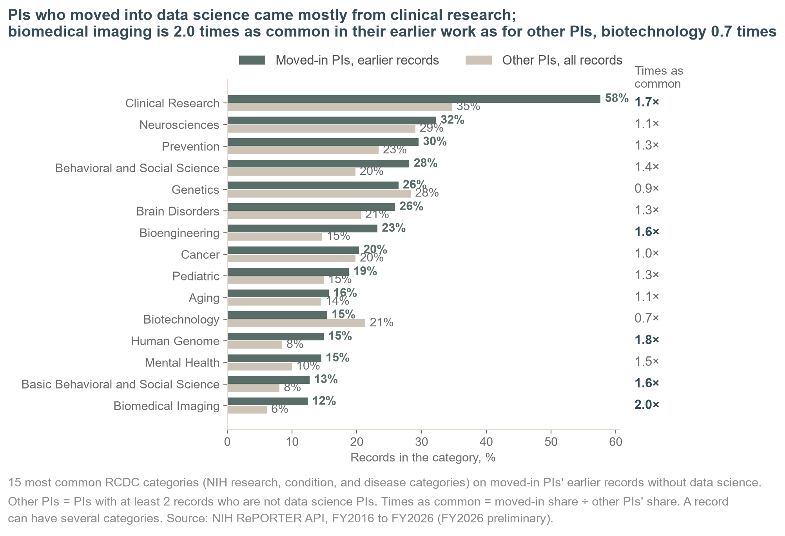

# New data science PIs: where they came from

**Laura Ellis** · [GitHub](https://github.com/Laura-Ellis/nih-ds-taxonomy) · Data through FY2026 (preliminary, as of October 24, 2026)

About 1 in 5 new data science principal investigators (PIs) moved in from other NIH research; the rest started their NIH record already doing data science. The ones who moved in came mostly from clinical research, and their earlier work leaned toward biomedical imaging, the human genome, and bioengineering, about twice as often as other PIs' work. Whatever their earlier area, most entered data science through statistics and analytics, and almost half brought in AI. About half did their first data science project at the same institute as their earlier work.

Part of [Who does data science at NIH, how they get there, and who they work with](pi_analysis.md).

## Definitions

| Term | Definition |
|---|---|
| Data science PI | At least 2 project records from FY2016 to FY2026, with substantive data science in more than half of them |
| Entry year | Fiscal year of the PI's first data science record |
| New data science PI | A data science PI whose entry year is FY2018 or later, so at least two earlier years are visible |
| Moved in | The PI had at least one record without data science in an earlier fiscal year |
| Started in data science | The PI's first record in the data is already data science: new to NIH, or new since FY2016 |
| Earlier areas | NIH research, condition, and disease categories (RCDC, NIH's own spending categories) on the PI's earlier records without data science |
| Times as common | A category's share of moved-in PIs' earlier records ÷ its share of other PIs' records. 1.0 = the same; 2.0 = twice as common |
| Other PIs | PIs with at least 2 records who are not data science PIs; all of their records |

## Most new data science PIs started there

Of 3,490 new data science PIs from FY2018 to FY2026, 706 (20%) moved in from other research. The share was steady at about 1 in 5 each year from FY2018 to FY2022. For those who moved in, the median gap between their first record and their first data science record was three years.

Counts fall after FY2022 because a PI needs at least two data science projects to count as a data science PI, and recent entrants have had little time to get a second one. Read the recent years as incomplete, not as a decline.

## Where the movers came from

Clinical research is the largest earlier area: 57% of moved-in PIs' earlier records are clinical research, compared with 35% of other PIs' records. The areas most over-represented in their earlier work are biomedical imaging (2.1 times as common), the human genome (2.0), clinical research (1.6), and bioengineering (1.5). These are fields that already produce large amounts of data, so the step into data science is short. Infectious diseases (0.6), rare diseases (0.7), and biotechnology (0.8) are under-represented.

Their earlier awards were mostly research grants: 60% had an earlier R award, 23% an earlier training award (F, K, T, R00, or R25), and 20% an earlier center or cooperative agreement award (P or U). A PI can have more than one type.

## How they entered data science

Whatever their earlier area, 80% of moved-in PIs' first data science records include statistics and analytics, 43% artificial intelligence, 41% data infrastructure, 38% computational modeling, and 37% software and tools. The earlier area shapes the rest. PIs from bioengineering entered through AI (58%), computational modeling (49%), and software (47%) more than others. PIs from genetics and prevention research entered through data infrastructure (50% and 48%), and PIs from cancer research through software (41%) and data infrastructure (47%).

## Same institute or a new one

About half (55%) of moved-in PIs did their first data science project at the same institute as most of their earlier work. NCI, NIMH, NEI, NIDA, and NIEHS kept the most (68% to 70%). PIs whose earlier work was at NIDDK (32%) or NIBIB (38%) were the most likely to enter data science at a different institute. For an institute, that means some of the data science capacity it builds ends up working on other institutes' problems.

## What this means

Most growth in data science PIs comes from people who start their NIH careers doing it, which puts weight on training and early-career awards (see [How they get there](pi_analysis.md#4-how-they-get-there)). The 1 in 5 who move in come from data-heavy fields, so programs that want to bring in researchers from areas where data science is thinner, such as rare and infectious diseases, may need to reach them directly. Statistics and analytics is the common entry point, and it is where training aimed at mid-career researchers would meet them.

## Method, data, and limits

- Source: NIH RePORTER API, FY2016 to FY2026 (FY2026 preliminary); NIH Data Science Taxonomy labels; RCDC categories as reported in RePORTER. Data science PI groups from `src/pi_tiers.py`.
- Code: `analyses/ds_pis/entrants.py`. Outputs in `reports/results/ds_entrants_*.csv` and `reports/figures/ds_entrants/`.
- Privacy: results are aggregate only; groups smaller than 11 PIs are suppressed.
- Limits: - Work before FY2016 isn't visible, so "started in data science" includes some PIs who had earlier NIH projects that ended before FY2016.
    - Recent entry years are undercounted because a data science PI needs at least two data science projects.
    - RCDC categories are missing on about 18% of records, mostly subprojects and some contracts.
    - Moved-in PIs' earlier work covers a few years; other PIs' records cover up to 11. Comparing shares of records, not shares of PIs, keeps the comparison fair.
    - Taxonomy groups come from titles and abstracts, not from what a project actually built or used.
