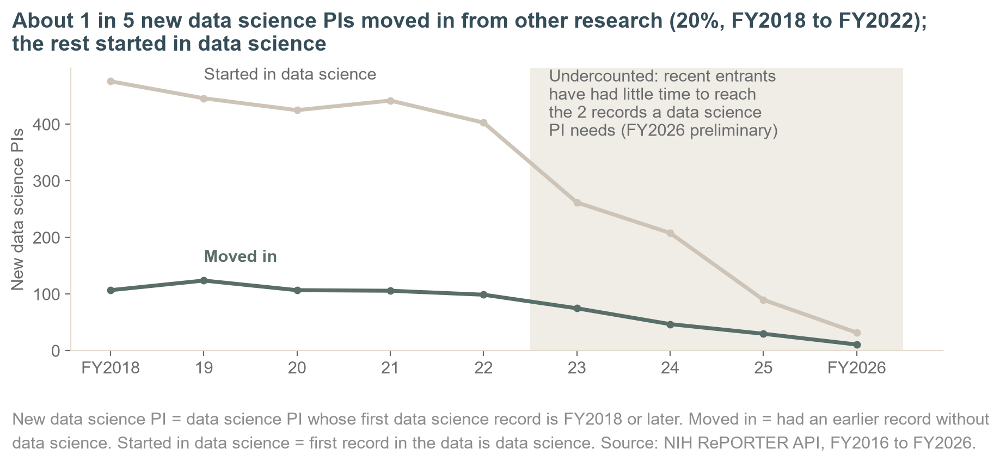
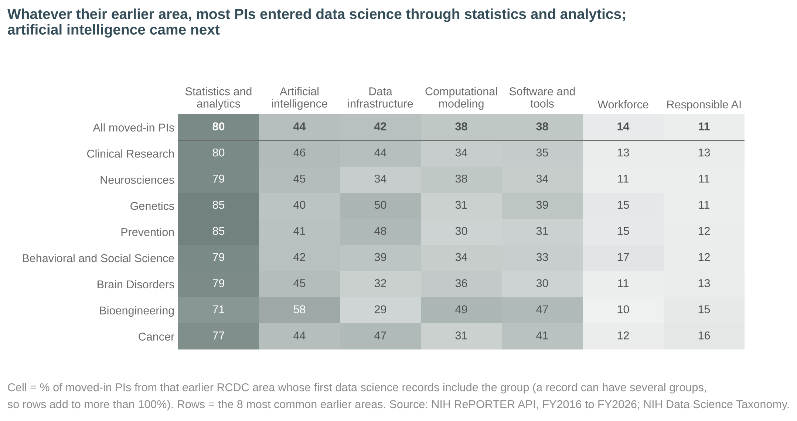

# New data science PIs: where they came from

**Laura Ellis** · [LinkedIn](https://www.linkedin.com/in/laura-ellis-profile/) · [GitHub](https://github.com/Laura-Ellis/nih-ds-taxonomy) · Data through FY2026 (preliminary, as of October 24, 2026)

About 1 in 5 new data science principal investigators (PIs) moved in from other NIH research. The rest were already doing data science on their first NIH project.

Those who moved in came mostly from clinical research. Their earlier work leaned toward data-heavy fields: biomedical imaging and the human genome show up about twice as often as in other PIs' work. Whatever their earlier field, most entered data science through statistics and analytics. About half started their first data science project at the same institute as their earlier work.

Part of [Who does data science at NIH, how they get there, and who they work with](pi_analysis.md). Terms are defined in the [glossary](#glossary) at the end.

## Most new data science PIs started there

Of 3,490 new data science PIs from FY2018 to FY2026, 706 (20%) moved in from other research. The share held at about 1 in 5 each year from FY2018 to FY2022. For those who moved in, the typical gap between their first NIH project and their first data science project was three years.

Counts fall after FY2022 for a simple reason: a PI needs at least two data science projects to count, and recent entrants have had little time to get a second one. Read the recent years as incomplete, not as a decline.

## Where the movers came from

Clinical research is the largest earlier field: 58% of moved-in PIs' earlier projects were clinical research, compared with 35% of other PIs' projects.

Compared with other PIs, their earlier work was:

- More often in biomedical imaging (2.0 times as common), the human genome (1.8), clinical research (1.7), and bioengineering (1.6). These fields already produce large amounts of data, so the step into data science is short.
- Less often in infectious diseases (0.6), rare diseases (0.7), and biotechnology (0.7).

Their earlier awards were mostly research grants: 61% had an earlier R award, 23% an earlier training award, and 19% an earlier center or cooperative agreement award (P or U). A PI can have more than one type.

## How they entered data science

Whatever their earlier field, most moved-in PIs' first data science projects included statistics and analytics (80%). Many also included AI (43%), data infrastructure (41%), computational modeling (38%), and software and tools (37%).

The earlier field shapes the rest:

- PIs from bioengineering entered through AI (58%), computational modeling (49%), and software (46%) more than others.
- PIs from genetics and prevention research entered through data infrastructure (47%).
- PIs from cancer research entered through data infrastructure (47%) and software (40%).

## Same institute or a new one

About half (55%) of moved-in PIs did their first data science project at the same institute as most of their earlier work. NCI, NIMH, NEI, NIDA, and NIEHS kept the most (68% to 74%). PIs from NIDDK (32%) and NIBIB (35%) were the most likely to move to a different institute. For an institute, that means some of the data science skill it builds ends up working on other institutes' problems.

## What this means

Most growth in data science PIs comes from people who start their NIH careers doing it. That puts weight on training and early-career awards (see [How they get there](pi_analysis.md#4-how-they-get-there)).

The 1 in 5 who move in come from data-heavy fields. Programs that want to bring in researchers from areas where data science is thinner, such as rare and infectious diseases, may need to reach them directly. Statistics and analytics is the common entry point, so that is where training for mid-career researchers would meet them.

## Method, data, and limits

**Source:** NIH RePORTER API, FY2016 to FY2026 (FY2026 preliminary); NIH Data Science Taxonomy labels; RCDC categories as reported in RePORTER. Data science PI groups from `src/pi_tiers.py`.

**Definitions:** entry year = fiscal year of the PI's first data science record. New data science PI = entry year FY2018 or later, so at least two earlier years are visible. Moved in = at least one earlier record without data science. Earlier areas = RCDC categories on those earlier records. Times as common = a category's share of moved-in PIs' earlier records ÷ its share of other PIs' records. Other PIs = PIs with at least 2 records who are not data science PIs.

**Code:** `analyses/ds_pis/entrants.py`. Outputs in `reports/results/ds_entrants_*.csv` and `reports/figures/ds_entrants/`.

**Privacy:** results are aggregate only; groups smaller than 11 PIs are suppressed.

**Limits:**

- Work before FY2016 isn't visible, so "started in data science" includes some PIs whose earlier NIH projects ended before FY2016.
- Recent entry years are undercounted because a data science PI needs at least two data science projects.
- RCDC categories are missing on about 18% of records, mostly subprojects and some contracts.
- Moved-in PIs' earlier work covers a few years; other PIs' records cover up to 11. Comparing shares of records, not shares of PIs, keeps the comparison fair.
- Taxonomy groups come from titles and abstracts, not from what a project actually built or used.

## Glossary

| Term | Meaning |
|---|---|
| Data science PI | A PI with 2 or more project records, more than half with substantive data science |
| Moved in | A data science PI who had an earlier NIH project without data science |
| PI | Principal investigator: a person who leads an NIH-funded project |
| RCDC | NIH's research, condition, and disease categories, used to tag every project |
| Started in data science | A data science PI whose first project in the data already used data science |
| Times as common | How much more often a field shows up in movers' earlier work than in other PIs' work; 1 = the same, 2 = twice as often |
