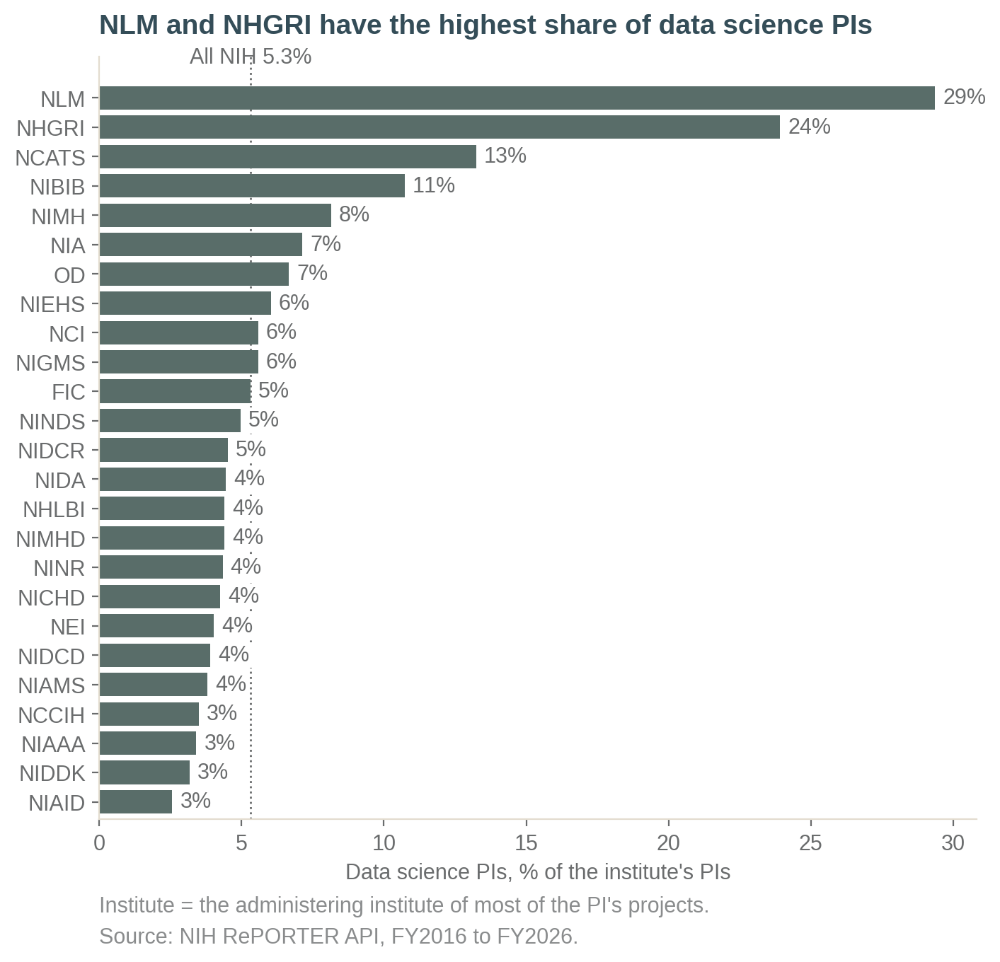
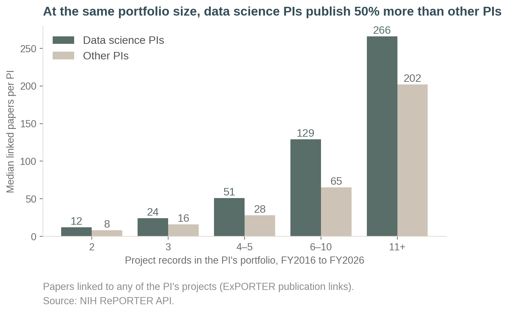
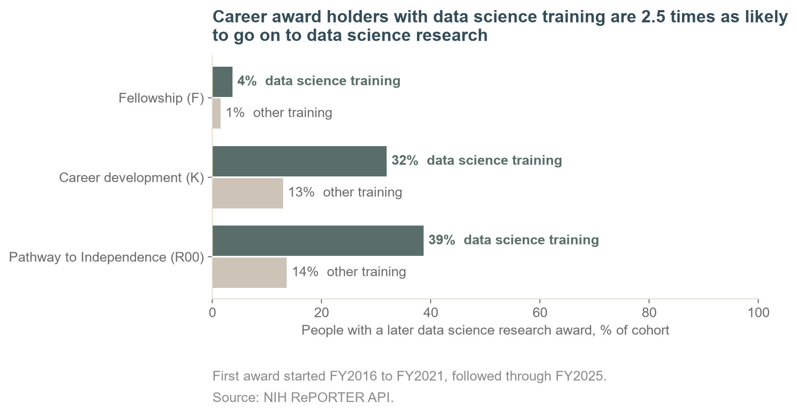
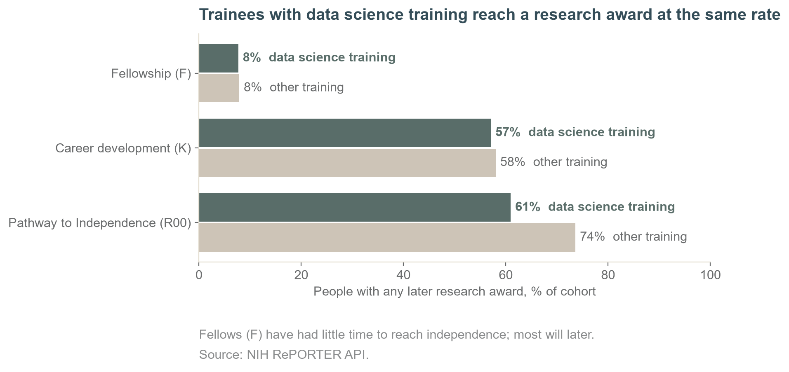
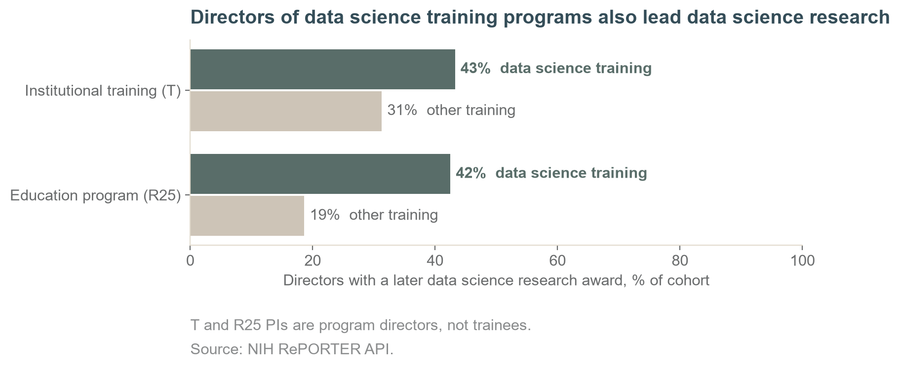
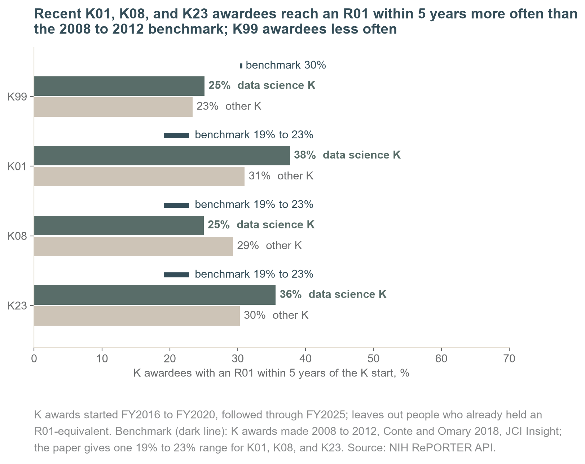
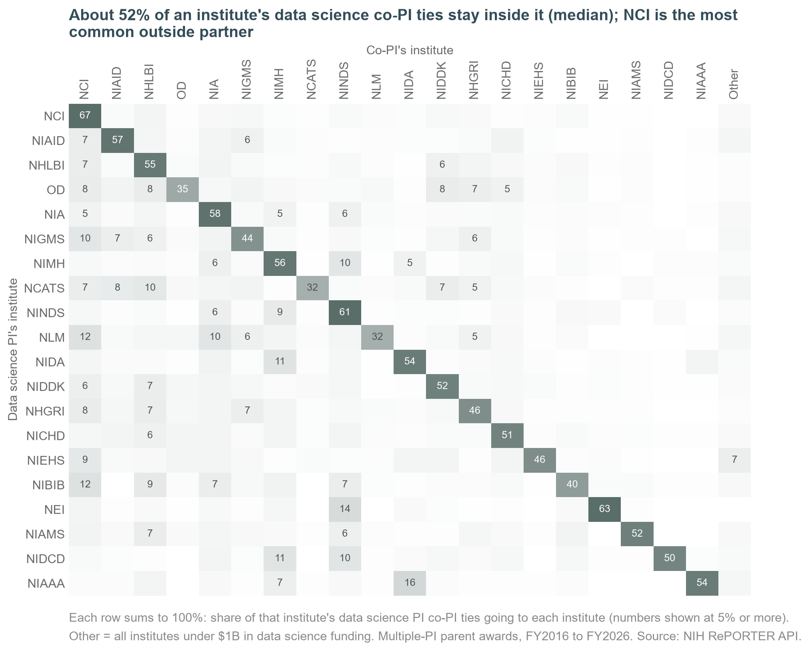
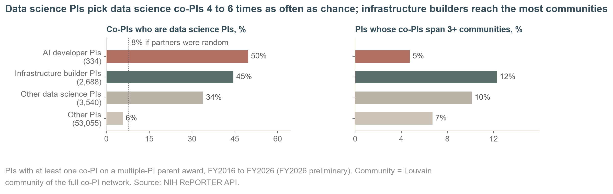

# Who does data science at NIH, how they get there, and who they work with

**Laura Ellis** · [LinkedIn](https://www.linkedin.com/in/laura-ellis-profile/) · [GitHub](https://github.com/Laura-Ellis/nih-ds-taxonomy) · Data through FY2026 (preliminary, as of October 24, 2026) · [Presentation (PDF)](https://laura-ellis.github.io/pdf/who_does_data_science_at_nih.pdf)

About 1 in 12 NIH principal investigators (PIs) now does mostly data science. In FY2016 it was 1 in 16.

Training is a main way in. People whose career development (K) award was a data science project start leading data science research about three times as fast as other K awardees. They reach their first R01 just as fast.

Data science PIs often team up with each other, and nearly half of their partnerships cross institute lines. Infrastructure builders connect the most groups of researchers. AI developers connect the fewest and publish fewer papers. That is the gap NIH's push to credit software, models, and data aims to close.

Terms are defined in the [glossary](#glossary) at the end.

## Contents

1. [Who counts](#1-who-counts)
2. [Growth and where they work](#2-growth-and-where-they-work)
3. [Builders and credit](#3-builders-and-credit)
4. [How they get there](#4-how-they-get-there)
5. [Who they work with](#5-who-they-work-with)
6. [What this means](#6-what-this-means)
7. [Method, data, and limits](#7-method-data-and-limits)
8. [Glossary](#glossary)

## 1. Who counts

| Group | Rule | PIs | % of all PIs |
|---|---|---:|---:|
| PI | Anyone listed on an NIH project record, not only the contact PI | 122,906 | 100% |
| Data science PI | 2 or more project records, with substantive data science in more than half | 6,530 | 5.3% |
| AI developer PI | A data science PI who builds new or better AI methods in more than half of their records | 334 | 0.3% |
| Infrastructure builder PI | A data science PI who builds software, platforms, data resources, or data standards in more than half of their records | 2,943 | 2.4% |
| Data science contributor | At least one data science record, but not most | 29,404 | 23.9% |
| Other PIs | 2 or more records, not data science PIs; the comparison group | 53,087 | 43.2% |

The two builder groups overlap; 255 PIs are in both. Half of all PIs (63,289) have only one project record, so they can't be data science PIs or part of the comparison group. A PI's institute is the one that runs most of their projects.

The cutoff matters. "More than half" gives 6,530 PIs. "At least half" would count a PI with one data science project out of two, and gives 11,312. A 25% cutoff gives 17,700; requiring every project gives 3,516.

## 2. Growth and where they work

Data science PIs grew from 6.3% of active PIs in FY2016 to 8.4% in FY2025. Most of the growth came before FY2022. Since then the share has held at 8.3% to 8.4%. FY2026 is incomplete, so its dip may not last.

Every institute has data science PIs, in very different shares. The National Library of Medicine (NLM, 29%) and the National Human Genome Research Institute (NHGRI, 24%) lead. Next are the National Center for Advancing Translational Sciences (NCATS, 13%) and the National Institute of Biomedical Imaging and Bioengineering (NIBIB, 11%). The NIH average is 5.3%. By count, the National Cancer Institute (NCI, 999) and the National Institute of General Medical Sciences (NIGMS, 734) have the most.

Most data science PIs work with AI in some way:

- 22% (1,415) develop AI on at least one project.
- 39% (2,516) apply or support AI.
- 40% (2,599) have no AI projects.

Data science PIs also publish more than other PIs with the same number of projects. For PIs with six to ten projects, the median is 129 linked papers vs. 65. Their papers are cited more for their fields, too (Relative Citation Ratio 2.37 vs. 2.05). Links to patents and clinical trials are about the same.

## 3. Builders and credit

AI developers and infrastructure builders look very different on the usual measures. I compared each group with data science PIs who have the same number of projects and started in the same period.

- AI developers have 27% fewer linked papers (16 vs. 22), slightly lower citation rates (2.17 vs. 2.32), and far fewer links to clinical trials (7% vs. 22%). Their work goes into models and code, which papers, patents, and trials don't capture.
- Infrastructure builders have 37% more linked papers (41 vs. 30) and higher citation rates (2.52 vs. 2.26). Shared software and data resources draw many users, and users cite them.

Builders also publish more in journals for software and data, such as *Bioinformatics*, *Scientific Data*, and *GigaScience*. These make up 2.9% of AI developers' papers and 2.0% of infrastructure builders', compared with 0.9% for other data science PIs.

NIH wants to credit this work. The NIH Strategic Plan for Data Science, 2025 to 2030, commits to credit and incentives for sharing data, to persistent identifiers that let researchers cite datasets and software, and to tracking how often NIH datasets and software are cited. In June 2026, NIH asked the public how to measure impact beyond publication and citation counts, and named data, software, and model sharing as an area to reward (NOT-OD-26-087). A planned pilot adds dataset and software identifiers (DOIs) and NCBI data deposits, so builders' work shows up directly: [Pilot: crediting software, models, and data](pilot_outputs_beyond_papers.md).

## 4. How they get there

### Training awards

NIH training awards come in two kinds. Trainee awards (fellowships F, career development K, and R00) name the trainee as PI, so I can follow each person. Program awards (institutional training T and education programs R25) name the program director, usually senior faculty; RePORTER doesn't list the trainees.

I followed everyone whose first award of a type started FY2016 to FY2021, through FY2025.

Data science training leads to data science research at every stage:

- 32% of data science K awardees went on to lead data science research, compared with 13% of other K awardees.
- For Pathway to Independence (R00) awardees, it was 39% vs. 14%.
- For AI, the gap is wider: 17% vs. 5%.

Data science training doesn't slow anyone down. Data science and other K awardees reach a later research award at the same rate (57% vs. 58%) and in the same median time (4 years). Fellows have had little time; about 8% in both groups have a research award so far.

Directors of data science training programs also lead data science research: 43% have a later data science research award, compared with 31% of other T directors and 19% of other R25 directors.

### Moving in from other research

Most new data science PIs start in data science. Of 3,490 who first did data science in FY2018 or later, 20% moved in from other NIH research, mostly clinical research. See [New data science PIs: where they came from](entrants.md).

### Time to data science research and to an R01

Following each K awardee year by year shows the same pattern. Nine years after the K started, 46% of data science K awardees had a data science research award, compared with 18% of other K awardees. Both groups reached a first R01 at the same pace (51% each by year 9).

I checked this three ways, and the answer held each time:

- Year-by-year curves: 46% vs. 18% reach data science research by year 9; 51% vs. 51% reach an R01.
- A model that holds K type, institute, and start year equal: data science K awardees reach data science research 3.1 times as fast each year (likely range 2.7 to 3.4). R01 timing shows no real difference.
- Pairing each data science K awardee with a similar other K awardee: 32% vs. 12% reach data science research; 57% vs. 56% reach any later research award.

A more flexible machine learning model did no better than the simpler one, so the simpler model is the right choice.

### Compared with published rates

A 2018 study (Conte and Omary) found that 19% to 23% of K01, K08, and K23 awardees from 2008 to 2012 reached an R01 within five years. Recent awardees here did better: 25% to 38%. K99 awardees did less well (23% to 25% vs. 30%), likely because they spend the first years in the K99 and R00 phases.

Within each K type, data science made little consistent difference: higher for K01 (38% vs. 31%) and K23 (36% vs. 30%), lower for K08 (25% vs. 29%).

Two differences raise the rates here slightly. This analysis counts an R01 on which the person is any listed PI, and multi-PI awards are more common now. It also starts the clock at the K's project start date, not the award year. For context, NIH reports a median age of about 42 at first R01-equivalent award.

## 5. Who they work with

A co-PI tie means two PIs lead the same award. I used 51,347 multi-PI awards with 87,017 ties, FY2016 to FY2026. Center subprojects and awards with more than 10 PIs are left out.

### Across institutes

The map shows institutes with more than $1B in data science funding, linked by their data science PIs' ties. NIMH and NINDS share the most (272 ties). NCI is the hub; it appears in 9 of the 20 strongest links.

Nearly half (46%) of data science PIs' ties are with a PI at a different institute. Ties between two data science PIs cross institute lines about as often (47%). PIs at NCATS, NLM, and the Office of the Director work across institutes the most, about two-thirds of their ties. PIs at NCI work inside their institute the most, partly because NCI is so large.

For the typical institute, about half of its data science PIs' ties stay inside it. NCI is the most common outside partner, then NINDS, NHLBI, and NIA.

### Builders as bridges

Data science PIs pick each other as co-PIs far more often than chance. If partners were random, about 8% of co-PIs would be data science PIs. Instead it is 34% for data science PIs overall, 44% for infrastructure builders, and 50% for AI developers: 4 to 6 times chance.

To see who connects separate groups, I split the network into research communities: groups of PIs who mostly work with each other. Infrastructure builders are the most likely to have co-PIs in three or more communities (12%, vs. 10% for other data science PIs and 7% for other PIs). This holds even among PIs with many co-PIs. AI developers are the least connected: 5% reach three or more communities, and 37% have no co-PI at all.

### Who teams up next

New partnerships mostly come from outside existing circles. Of 1,705 new ties from FY2022 to FY2026 that involve a data science PI, 74% are with a PI outside data science. Only 9% are between PIs already in the same community.

I tested four ways to predict which PIs would team up for the first time. Shared co-PIs barely predict new ties, because most new partners had none in common. Being at the same institute was the strongest predictor, followed by how many co-PIs each PI already had. A simple model did as well as a complex one (AUC 0.82 for both; 0.5 = chance, 1 = perfect).

## 6. What this means

Data science is a core part of NIH research. About 1 in 12 funded investigators builds their work around it, and they are productive by the usual measures.

Career development awards are one of the clearest routes in. Data science K awardees move into data science research three times as fast as other K awardees, with no delay to an R01. Goal 5 of the NIH Strategic Plan for Data Science calls for a broad data science workforce, and career awards are a lever NIH can measure.

The flat share since FY2022 is the open question. It could reflect a maturing field, tighter budgets, or a shift toward AI within the same group of PIs.

Infrastructure builders are the connectors: they publish more, are cited more, and reach more research communities. AI developers are the opposite on every easy-to-count measure, yet they build the models others use. Counting software, models, and data would show what they produce. New partnerships rarely come from existing circles, so programs that pair data science PIs with other institutes and fields are where new collaborations are most likely to start.

## 7. Method, data, and limits

**Source:** NIH RePORTER API, FY2016 to FY2026, NIH institutes and centers only. FY2026 is preliminary. Labels come from the NIH Data Science Taxonomy (keywords, then two large language models, checked against hand coding: κ = 0.86 for data science, 0.92 for AI).

**Outputs:** ExPORTER publication links, iCite Relative Citation Ratio, and ExPORTER patent and clinical study links, for all of a PI's projects.

**Matching (builders):** comparison PIs are weighted to each builder group's mix of portfolio size (2, 3, 4 to 5, 6 to 10, 11 or more records) and first data science year (FY2016 to FY2018, FY2019 to FY2021, FY2022 to FY2026).

**Training:** cohorts start from the project start date of a person's first award of each type. Later research award = any non-training, non-intramural award (R, U, P, and similar) after the start year. R01-equivalent = R01, R37, RF1, R56, DP1, DP2, DP5, RL1, U01, and R35. People who already held an R01-equivalent are left out of the R01 measures.

| Method | What it compares | Data science research | First R01 |
|---|---|---|---|
| Kaplan-Meier curves | Share reaching the outcome by each year, counting people only for the years we can see | 46% vs. 18% by year 9 | 51% vs. 51% by year 9 |
| Cox model | Yearly rate of reaching the outcome, holding K type, institute, and start year fixed | 3.1× (95% interval 2.7 to 3.4) | 1.07× (0.96 to 1.18) |
| Propensity score matching | Each data science K awardee paired with a similar other K awardee | 32% vs. 12%, +20 points (17 to 23) | Any later research award: 57% vs. 56% |

Kaplan-Meier cumulative share = 1 − the product, over years, of (1 − people reaching the outcome that year ÷ people still followed that year). Cox proportional hazards model fit with statsmodels. Random survival forest (scikit-survival, 300 trees) and Cox compared on a 25% held-out set (concordance 0.68 for both on data science research, 0.61 for both on R01). Propensity score from logistic regression; nearest-neighbor matching within 0.2 standard deviations of the logit; 95% intervals from 1,000 bootstrap samples.

**Network:** co-PI ties from multi-PI parent awards. Communities by the Louvain method (networkx). Betweenness estimated from 500 sampled PIs. Link prediction trained on FY2016 to FY2021 ties and tested on new ties from FY2022 to FY2026:

| Model | What it uses | AUC | Average precision |
|---|---|---:|---:|
| Adamic-Adar score (baseline) | Shared co-PIs, weighting rarely connected ones more | 0.54 | 0.54 |
| Graph embedding + logistic regression | Each PI's network position as 32 numbers | 0.57 | 0.61 |
| Gradient boosting | Network measures plus same institute, same community, and data science status | 0.82 | 0.83 |
| Logistic regression | Same features as gradient boosting | 0.82 | 0.84 |

Non-ties are random pairs, so scores are higher than they would be in real use; compare the models with each other.

**Privacy:** results are aggregate only; groups smaller than 11 people are suppressed. No PI names or IDs are published.

**Code:** `src/pi_tiers.py` defines the PI groups; `notebooks/15_pi_profiles.py` builds the PI profiles; `analyses/ds_pis/ds_pis.py` (sections 1 to 3), `training.py` and `entrants.py` (section 4), and `networks.py` (section 5) make the tables and charts.

**Limits:**

- Papers are linked by project number, so a PI on a center or multi-PI project gets credit for all of that project's papers. Some fields publish more often than others.
- PI profile IDs can split or merge when people change institutions, which shifts counts slightly.
- Builder groups come from titles and abstracts, not from the software or data a project actually released.
- Training before FY2016 is visible only through project start dates. Institutional trainees can't be followed. Fellows need more follow-up time.
- The training results are associations. People who choose a data science training project were likely already headed toward data science.
- Co-PI ties capture formal partnerships only, not subawards, shared papers, or shared data.

**Sources:** [NIH Strategic Plan for Data Science, 2025 to 2030](https://datascience.nih.gov/nih-strategic-plan-data-science); [NOT-OD-26-087, Request for Information on Measuring and Rewarding Scientific Impact](https://grants.nih.gov/grants/guide/notice-files/NOT-OD-26-087.html), June 18, 2026; [Conte and Omary 2018, NIH career development awards: conversion to research grants and regional distribution, JCI Insight](https://jci.org/articles/view/123875); [NIH Extramural Nexus, age at first R01-equivalent award, August 2026](https://grants.nih.gov/news-events/nih-extramural-nexus-news/2026/08/age-at-first-r01-equivalent-award-remains-stable-since-fy21).

## Glossary

| Term | Meaning |
|---|---|
| AI developer PI | A data science PI whose projects mostly build new or better AI methods |
| AUC | How well a model separates two groups: 0.5 = coin flip, 1 = perfect |
| Co-PI tie | Two PIs who lead the same multi-PI award |
| Cox model | A model that compares how fast two groups reach an event each year |
| Data science PI | A PI with 2 or more project records, more than half with substantive data science |
| Infrastructure builder PI | A data science PI whose projects mostly build software, platforms, or data resources |
| K award | An NIH career development award that funds early-career researchers' training and research time |
| κ (kappa) | Agreement with hand coding beyond chance: 1 = perfect, 0 = chance |
| PI | Principal investigator: a person who leads an NIH-funded project |
| R00 | The independent phase of the K99/R00 Pathway to Independence award |
| R01 | NIH's standard independent research grant; a first R01 is a common career milestone |
| Relative Citation Ratio (RCR) | Citations per year compared with the field's norm; 1 = a typical NIH paper |
| Research community | A group of PIs who mostly work with each other, found from co-PI ties |
| Substantive data science | Data science in a project's aims or stated approach, not just mentioned |

## How the methods work, in plain terms

- **Data science labels.** Each project is tagged by keyword rules first, then by two large language models (AI systems that read text) that decide whether data science is central to the project. Their tags agree with people's hand coding almost as well as people agree with each other (kappa 0.86 for data science, 0.92 for AI; 1 is perfect).
- **Fair comparison groups (weighting and matching).** Builder PIs are compared with other data science PIs who have the same mix of portfolio size and start year, so differences aren't just because one group is bigger or older.
- **Kaplan-Meier curves.** Show the share of people who reach a milestone (such as a first R01) by each year, while fairly counting people we've only been able to follow for a few years.
- **Cox model.** Compares how fast two groups reach a milestone each year, holding grant type, institute, and start year steady. "3.1×" means three times as fast.
- **Random survival forest.** A set of 300 decision trees that predicts the same milestone timing. It's a check on the Cox model: both predict about equally well.
- **Propensity score matching.** Pairs each data science K awardee with a similar K awardee who isn't in data science (similar grant type, institute, and timing), then compares what happened to each pair.
- **Bootstrap intervals.** Re-runs the analysis on 1,000 random resamples of the people to show how much a result could move by chance. The 95% interval is the middle 95% of those results.
- **Research communities (Louvain method).** Finds groups of PIs who mostly work with each other, like friend circles in a social network.
- **Bridges (betweenness).** Scores how often a PI sits on the shortest path between two others, so high scorers connect groups that wouldn't otherwise meet.
- **Who teams up next (link prediction).** Models trained on partnerships through FY2021 guess which pairs of PIs will team up later, then are checked against the real new partnerships. The simplest one counts shared partners. The best ones (gradient boosting, a set of decision trees, and logistic regression, a weighted checklist) also use same institute, same community, and data science status. AUC grades them: 0.5 is a coin flip, 1 is perfect.
