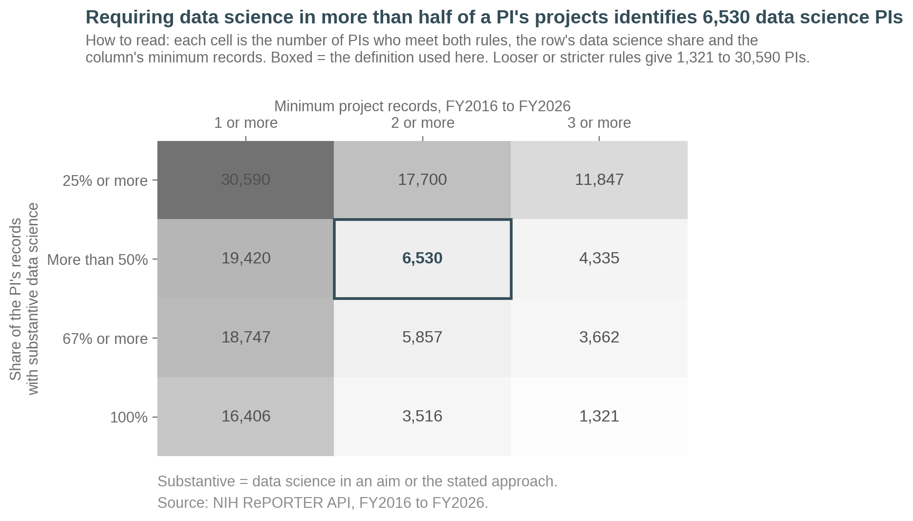
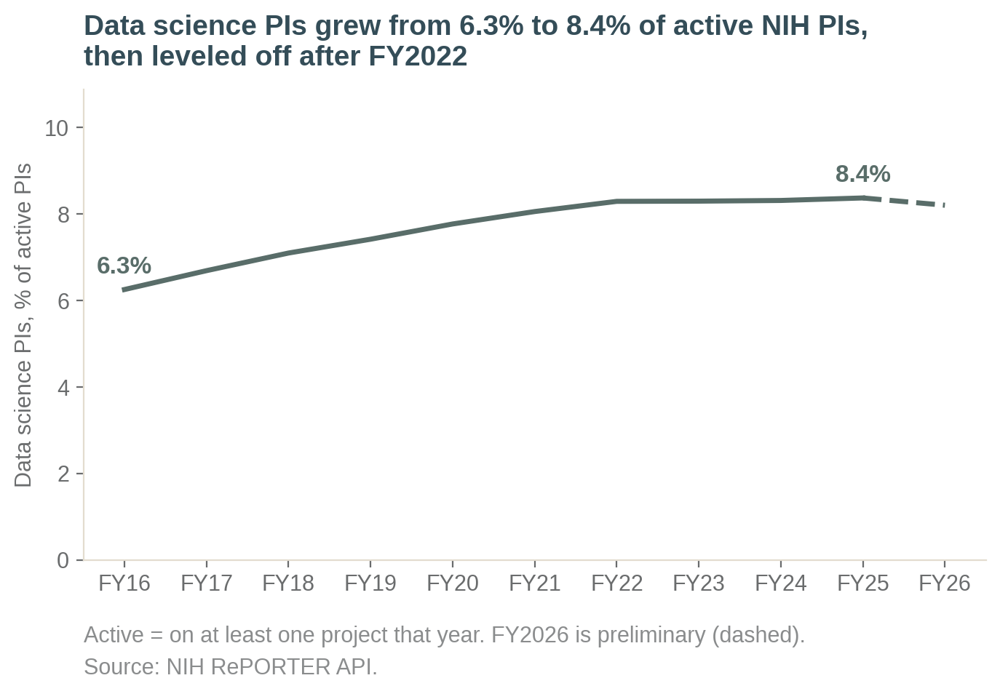
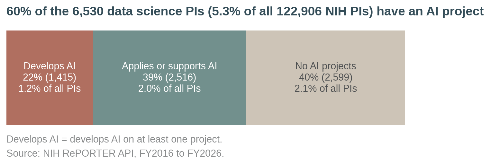
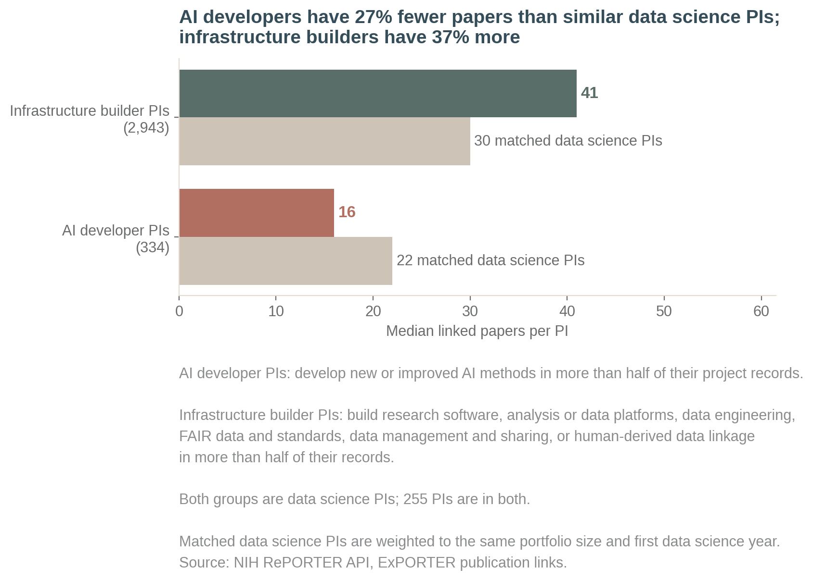
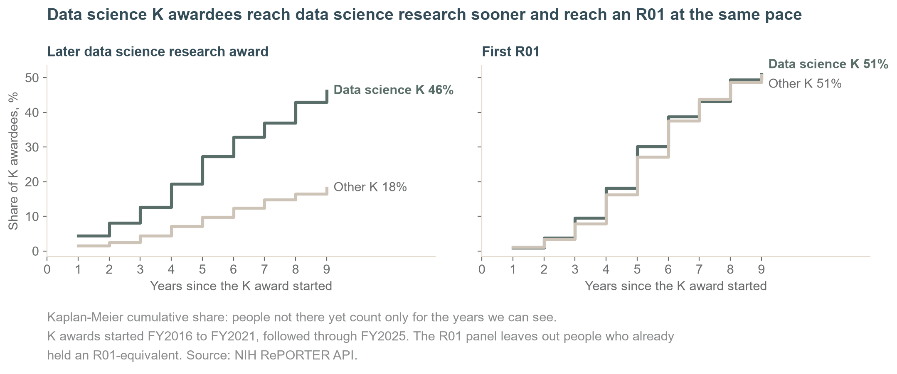
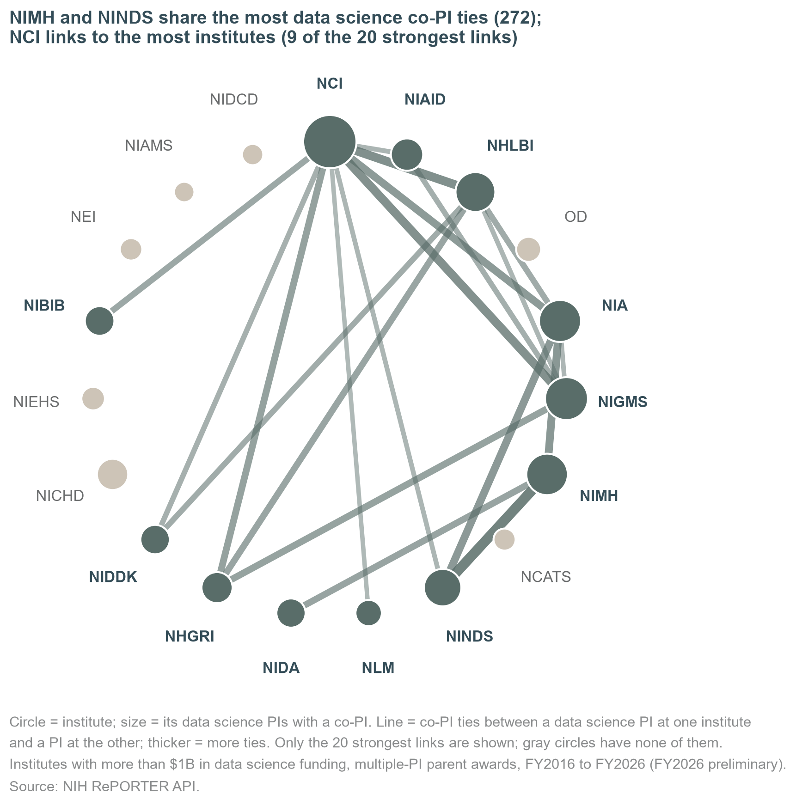
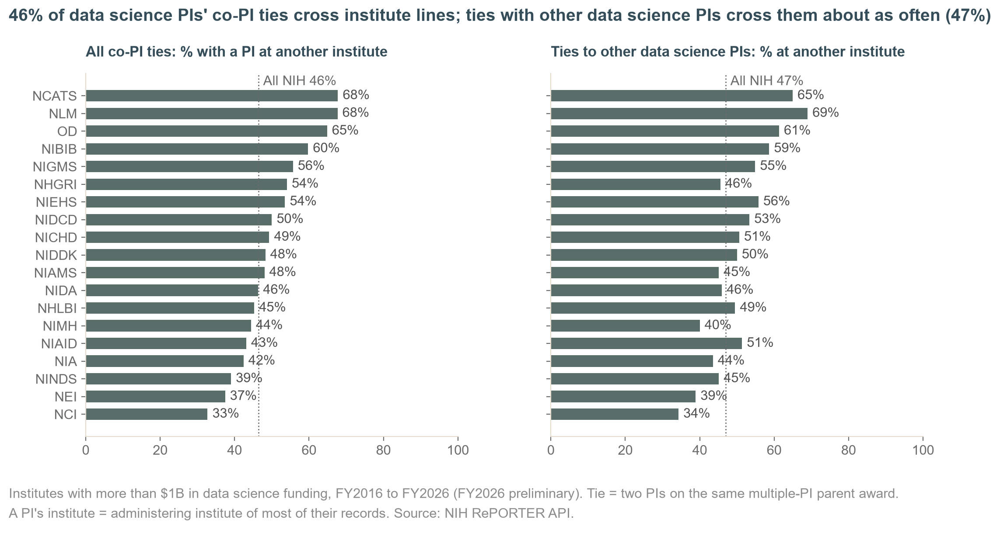
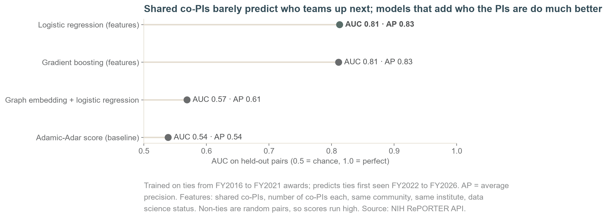

# Who does data science at NIH, how they get there, and who they work with

**Laura Ellis** · [GitHub](https://github.com/Laura-Ellis/nih-ds-taxonomy) · Data through FY2026 (preliminary, as of October 24, 2026)

About 1 in 12 active NIH principal investigators (PIs) now does mostly data science, up from 1 in 16 in FY2016. Many get there through training: people whose career development (K) award was a data science project are about three times as likely each year to start leading data science research as other K awardees, and they reach an R01 just as fast. Once there, data science PIs pick other data science PIs as co-PIs far more often than chance, but nearly half of their ties cross institute lines. Infrastructure builders connect the most separate groups of researchers. AI developers connect the fewest and publish fewer papers, which is the gap NIH's push to credit software, models, and data aims to close.

## Contents

1. [Who counts](#1-who-counts)
2. [Growth and where they work](#2-growth-and-where-they-work)
3. [Builders and credit](#3-builders-and-credit)
4. [How they get there](#4-how-they-get-there)
5. [Who they work with](#5-who-they-work-with)
6. [What this means](#6-what-this-means)
7. [Method, data, and limits](#7-method-data-and-limits)

## 1. Who counts

| Group | Definition | PIs | % of all PIs |
|---|---|---:|---:|
| PI | Anyone listed on a project record (RePORTER profile ID), not only the contact PI. A multi-PI project counts for each PI. | 122,906 | 100% |
| Data science PI | At least 2 project records from FY2016 to FY2026, with substantive data science (in an aim or the stated approach) in more than half of them | 6,530 | 5.3% |
| AI developer PI | A data science PI whose projects develop new or improved AI methods (AI role "develops AI") in more than half of their records | 334 | 0.3% |
| Infrastructure builder PI | A data science PI who builds data infrastructure in more than half of their records: research software, analysis platforms, data platforms and repositories, data engineering, FAIR data and standards, data management and sharing, or human-derived data linkage | 2,943 | 2.4% |
| Data science contributor | Any PI with at least one data science record who is not a data science PI: data science is part of their work, not most of it | 29,404 | 23.9% |
| Other PIs | PIs with at least 2 records who are not data science PIs; the comparison group | 53,087 | 43.2% |

The two builder groups overlap: 255 PIs are both. Half of all PIs (63,289) appear on only one project record, so they can't be data science PIs or part of the comparison group. A PI's institute is the administering institute of most of their records.

Requiring more than half of a PI's records matters. With "at least half," a PI with one data science project out of two would count, and that rule gives 11,312 PIs. Lowering the share to 25% gives 17,700; requiring every record gives 3,516.

## 2. Growth and where they work

Data science PIs went from 6.3% of active PIs in FY2016 to 8.4% in FY2025. Most of that growth came before FY2022; since then the share has stayed between 8.3% and 8.4%. FY2026 is incomplete, so its dip may not hold.

Every institute has data science PIs, in very different proportions. The National Library of Medicine (NLM, 29%) and the National Human Genome Research Institute (NHGRI, 24%) lead, followed by the National Center for Advancing Translational Sciences (NCATS, 13%) and the National Institute of Biomedical Imaging and Bioengineering (NIBIB, 11%). Across all NIH PIs the share is 5.3%. In absolute numbers, the National Cancer Institute (NCI, 999) and the National Institute of General Medical Sciences (NIGMS, 734) have the most.

Most work on AI in some way. Of the 6,530 data science PIs, 22% (1,415) develop AI on at least one project, 39% (2,516) apply or support AI, and 40% (2,599) have no AI projects. Against all 122,906 NIH PIs, that is 1.2%, 2.0%, and 2.1%.

They also publish more than other PIs with the same number of projects. Both groups have a median of 3 project records, so I compared them within the same portfolio size. At every size, data science PIs have more linked papers, for example 129 vs. 65 for PIs with six to ten records. Their papers are also cited more relative to their fields (median of each PI's mean Relative Citation Ratio, 2.37 vs. 2.05). Links to patents and clinical trials are about the same.

## 3. Builders and credit

AI developers and infrastructure builders look very different on traditional measures. Compared with data science PIs who have the same portfolio size and started in the same period:

- AI developers have 27% fewer linked papers (16 vs. 22), slightly lower citation rates (2.17 vs. 2.32), and far fewer links to clinical trials (7% vs. 22%). Their work goes into models and code that papers, patents, and trials don't capture.
- Infrastructure builders have 37% more linked papers (41 vs. 30) and higher citation rates (2.52 vs. 2.26). Shared data resources and software attract many users, and users cite them.

Builders also publish more of their papers in journals that mainly publish software tools and data resources (*Bioinformatics*, *BMC Bioinformatics*, *Scientific Data*, *Database*, *GigaScience*, and similar): 2.9% of an AI developer's linked papers and 2.0% of an infrastructure builder's, compared with 0.9% for other data science PIs. About 41% of infrastructure builders have at least one such paper, compared with 26% of other data science PIs.

The NIH Strategic Plan for Data Science, 2025 to 2030, asks for this kind of credit. It commits NIH to "enhance programs providing credit and incentives for sharing data" (Objective 1-1), to support "persistent unique data identifiers" through DataCite so researchers can "cite and reuse research outputs" (Objective 1-2), and to enhance "data citation practices" (Objective 1-3). It measures progress partly by "citations of datasets deposited" (Goal 1) and "increased citation of NIH software across broader communities" (Goal 3). In June 2026, NIH asked the public how to measure and reward scientific impact beyond "individual-level indicators of productivity" such as publication and citation counts, and named data, software, and model sharing as one of seven areas where it "seeks to incentivize and reward these activities" (NOT-OD-26-087). A planned pilot adds dataset and software DOIs and NCBI data deposits linked to NIH awards, so builders' work shows up directly: [Pilot: crediting software, models, and data](pilot_outputs_beyond_papers.md).

## 4. How they get there

### Training awards

| Term | Definition |
|---|---|
| Training award | Activity code F (fellowship), K (career development, including K99), R00 (independent phase of the K99/R00 Pathway to Independence award), T (institutional training), or R25 (education program) |
| Trainee award | F, K, and R00. The person listed as PI is the trainee, so these follow an individual's path. |
| Program award | T and R25. The person listed is the program director, usually senior faculty; RePORTER doesn't list the trainees. |
| Data science training award | A training award with substantive data science |
| Start year | Fiscal year of the project start date of the person's first award of that type. Using the start date keeps people whose award began before FY2016 out of the cohorts. |
| Cohort | People whose first award of a training type started FY2016 to FY2021, followed through FY2025 (the last complete fiscal year) |
| Later research award | Any non-training, non-intramural award (R, U, P, and similar) in a fiscal year after the start year |
| R01-equivalent | NIH's list: R01, R37, RF1, R56, DP1, DP2, DP5, RL1, U01, and R35 |

Data science training leads to data science research at every stage. A third of data science K awardees (32%) went on to lead data science research, compared with 13% of other K awardees; for Pathway to Independence (R00) awardees it was 39% vs. 14%. The gap is wider for AI: 17% of data science K awardees went on to AI research, compared with 5% of other K awardees.

Data science training doesn't slow anyone down. Data science and other K awardees reach a later research award at the same rate (57% vs. 58%) and in the same median time (4 years). Fellows have had little time to reach independence; about 8% have a research award so far, in both groups.

People who run data science training programs also lead data science research: 43% of data science T and R25 directors have a later data science research award, compared with 31% of other T directors and 19% of other R25 directors.

### Moving in from other research

Most new data science PIs start there: of 3,519 who first did data science in FY2018 or later, 21% moved in from other NIH research. Those who moved in came mostly from clinical research, and from imaging and genome research about twice as often as other PIs. See [New data science PIs: where they came from](entrants.md).

### Time to data science research and to an R01

Following each K awardee year by year shows the same pattern over time. Nine years after the K started, 46% of data science K awardees had a data science research award, compared with 18% of other K awardees. The two groups reached a first R01 at the same pace (51% each by year 9).

I checked this three ways, and the answer held:

| Method | What it compares | Data science research | First R01 |
|---|---|---|---|
| Kaplan-Meier curves | Share reaching the outcome by each year, counting people only for the years we can see | 46% vs. 18% by year 9 | 51% vs. 51% by year 9 |
| Cox model | Yearly rate of reaching the outcome, holding K type, institute, and start year fixed | 3.1 times as fast (95% interval 2.7 to 3.4) | 1.07 times (0.96 to 1.18), no real difference |
| Propensity score matching | Each data science K awardee paired with a similar other K awardee (same mix of K type, institute, and start year) | 32% vs. 12%, +20 points (17 to 23) | Any later research award: 57% vs. 56%, +1 point (−2 to 4) |

A random survival forest, a more flexible model, predicted who reaches each outcome first no better than the Cox model (concordance index 0.68 for both on data science research, 0.61 for both on R01; 0.5 = coin flip, 1.0 = perfect). The relationships are simple enough that the simpler model is the better choice.

### Compared with published K-to-R01 rates

Recent K01, K08, and K23 awardees reached an R01 within five years more often than the 2008 to 2012 cohort studied by Conte and Omary (25% to 38% here vs. 19% to 23%). K99 awardees reached one less often (23% to 25% vs. 30%), likely because many K99 awardees spend the first years on the K99 and R00 phases. Within each K type, data science made little consistent difference: higher for K01 (38% vs. 31%) and K23 (36% vs. 30%), lower for K08 (25% vs. 29%). Over seven years, 46% of data science K awardees and 47% of others had an R01. The broader R01-equivalent measure gives the same picture (38% vs. 36% within five years).

Two differences from the benchmark are worth stating. This analysis counts an R01 on which the person is any listed PI, including multi-PI awards, which were less common in 2008 to 2012. It also starts the clock at the K's project start date, while the paper counts from the year of the K award. Both would raise the rates here slightly. For age context, NIH reports a median age of about 42 at first R01-equivalent award, stable from FY2021 to FY2025.

## 5. Who they work with

A co-PI tie means two PIs are listed on the same parent award. Center subprojects are left out, so a center doesn't tie every subproject leader to every other one, and awards with more than 10 PIs are left out. That gives 51,347 multiple-PI awards and 87,017 ties, FY2016 to FY2026.

### Across institutes

The simplest view is a map of institutes with more than $1B in data science funding, linked by their data science PIs' co-PI ties. NIMH and NINDS share the most (272 ties), followed by NCI with NHLBI and NCI with NIGMS. NCI is the hub: it appears in 9 of the 20 strongest links. NIDCD, NIAMS, NEI, NIEHS, NICHD, NCATS, and the Office of the Director have none of the 20 strongest links, though most still work across institutes (below).

Of data science PIs' co-PI ties, 46% are with a PI whose main institute is different. Ties between two data science PIs cross institute lines about as often (47%). Data science PIs at NCATS, NLM, and the NIH Office of the Director (mostly Common Fund programs) work across institutes the most, about two-thirds of their ties. Those at NCI work inside their own institute the most, two-thirds of their ties, which partly reflects how large NCI is. Overall, 61% of data science PIs' ties are with PIs who aren't data science PIs.

For the typical institute, about half of its data science PIs' ties stay inside it. NCI is the most common outside partner, followed by NINDS, NHLBI, and NIA. Some pairs stand out: NIMH with NINDS and NIDA, NEI with NINDS, and NLM with NCI and NIA.

### Builders as bridges

Data science PIs pick other data science PIs as co-PIs far more often than chance. If partners were random, about 8% of co-PIs would be data science PIs. Instead it is 34% for other data science PIs, 45% for infrastructure builders, and 50% for AI developers.

To see who connects separate groups, I split the network into communities: groups of PIs who share awards with each other much more than with everyone else (Louvain method). Infrastructure builders are the most likely to have co-PIs in three or more communities (12%, vs. 10% for other data science PIs and 7% for other PIs), and they sit on more of the shortest paths between other PIs (betweenness). Part of this is that builders have more co-PIs (a median of 3 vs. 2 for other PIs). Among PIs with nine or more co-PIs, builders still reach the most communities (3.1 on average, vs. 2.9 for other data science PIs and 2.7 for other PIs). AI developers are the least connected: 5% reach three or more communities, and 37% have no co-PI at all.

### Who teams up next

New partnerships mostly come from outside existing circles. Of the 1,705 new ties formed from FY2022 to FY2026 that involve a data science PI, 74% are with a PI outside data science, and only 9% are between PIs who were already in the same community in FY2021.

I compared four ways to predict which pairs of PIs who had never shared an award would do so later, training on the FY2016 to FY2021 network and testing on new ties from FY2022 to FY2026:

| Model | What it uses | AUC | Average precision |
|---|---|---:|---:|
| Adamic-Adar score (baseline) | Shared co-PIs, counting shared co-PIs with few ties more | 0.54 | 0.54 |
| Graph embedding + logistic regression | Each PI's position in the network compressed to 32 numbers | 0.57 | 0.61 |
| Gradient boosting | Network measures plus same institute, same community, and data science status | 0.81 | 0.83 |
| Logistic regression | Same features as gradient boosting | 0.81 | 0.83 |

AUC = area under the ROC curve (0.5 = chance, 1.0 = perfect). Shared co-PIs barely predict new ties, because most new partners had no co-PIs in common. Being at the same institute was the strongest single predictor, followed by how many co-PIs each PI already had. The simple logistic regression did as well as gradient boosting. Non-ties are random pairs, so the scores are higher than they would be in real use; compare the models with each other.

## 6. What this means

Data science is a core part of NIH research: about 1 in 12 funded investigators builds their work around it, and they are productive by the usual measures. Career development awards are one of the clearest routes in. Data science K awardees move into data science research at three times the rate of other K awardees, with no cost to reaching an R01. Goal 5 of the NIH Strategic Plan for Data Science calls for strengthening a broad data science community, and individual career awards are a measurable lever for it.

The flat share since FY2022 is the open question. It could reflect a maturing field, tighter budgets, or a shift toward AI within the same group of PIs.

Infrastructure builders are the connectors: they publish more, are cited more, and reach across more research communities than other PIs. AI developers are the opposite on every measure that is easy to count. They have fewer papers, fewer clinical trial links, and fewer co-PIs, yet they build the models others use. Judged by papers and partnerships alone, their work looks smaller than it is. Counting software, models, and data, as NIH's Strategic Plan and NOT-OD-26-087 propose, would show what they produce. New partnerships rarely come from existing circles, so programs that put data science PIs together with researchers at other institutes and in other fields are where new collaborations are most likely to start.

## 7. Method, data, and limits

**Source:** NIH RePORTER API, FY2016 to FY2026, NIH institutes and centers only. FY2026 is preliminary. Labels come from the NIH Data Science Taxonomy (keywords, then two large language models, checked against hand coding: κ = 0.86 for data science, 0.92 for AI).

**Outputs:** ExPORTER publication links, iCite Relative Citation Ratio (citations per year ÷ the field's expected rate; 1.0 = median NIH paper), and ExPORTER patent and clinical study links, for all of a PI's projects.

**Matching (builders):** comparison PIs are weighted to each builder group's mix of portfolio size (2, 3, 4 to 5, 6 to 10, 11 or more records) and first data science year (FY2016 to FY2018, FY2019 to FY2021, FY2022 to FY2026).

**Training models:** Kaplan-Meier cumulative share = 1 − the product, over years, of (1 − people reaching the outcome that year ÷ people still followed that year). Cox proportional hazards model fit with statsmodels; hazard ratio = how many times as fast one group reaches the outcome each year. Random survival forest (scikit-survival, 300 trees) and Cox compared on a 25% held-out set with Harrell's concordance index. Propensity score = predicted chance of a data science K from K type, institute, and start year (logistic regression); nearest-neighbor matching with replacement within 0.2 standard deviations of the logit; 95% intervals from 1,000 bootstrap samples. People who already held an R01-equivalent are left out of the R01 measures.

**Network:** co-PI ties from multiple-PI parent awards. Communities by the Louvain method (networkx). Betweenness estimated from 500 sampled PIs. Link prediction features: common co-PIs, Adamic-Adar, Jaccard, preferential attachment (log), same FY2021 community, same institute, both data science PIs, one data science PI. Graph embedding = truncated singular value decomposition (32 dimensions) of the degree-normalized adjacency matrix. Test set = 30% of pairs.

**Privacy:** results are aggregate only; groups smaller than 11 people are suppressed. No PI names or IDs are published.

**Code:** `src/pi_tiers.py` defines the PI groups; `notebooks/15_pi_profiles.py` builds the PI profiles; `analyses/ds_pis/ds_pis.py` (sections 1 to 3), `training.py` and `entrants.py` (section 4), and `networks.py` (section 5) make the tables and charts.

**Limits:**

- Papers are linked by project number, so a PI on a center or a multi-PI project gets credit for all of that project's papers. Some fields publish more often than others.
- PI profile IDs can split or merge when investigators change institutions, which shifts counts slightly.
- Builder groups depend on the taxonomy's categories and AI roles, which come from titles and abstracts, not from the software or data a project actually released.
- Training before FY2016 isn't visible except through project start dates. Institutional trainees (T32 and similar) can't be followed because RePORTER doesn't list them. Fellows need more follow-up time.
- The training results are associations. Matching removes differences in K type, institute, and start year, but people who choose a data science training project were likely already headed toward data science.
- Co-PI ties capture formal partnerships only. Collaborations through subawards, papers, or shared data don't show up.

**Sources:** [NIH Strategic Plan for Data Science, 2025 to 2030](https://datascience.nih.gov/nih-strategic-plan-data-science); [NOT-OD-26-087, Request for Information on Measuring and Rewarding Scientific Impact](https://grants.nih.gov/grants/guide/notice-files/NOT-OD-26-087.html), June 18, 2026; [Conte and Omary 2018, NIH career development awards: conversion to research grants and regional distribution, JCI Insight](https://jci.org/articles/view/123875); [NIH Extramural Nexus, age at first R01-equivalent award, August 2026](https://grants.nih.gov/news-events/nih-extramural-nexus-news/2026/08/age-at-first-r01-equivalent-award-remains-stable-since-fy21).
