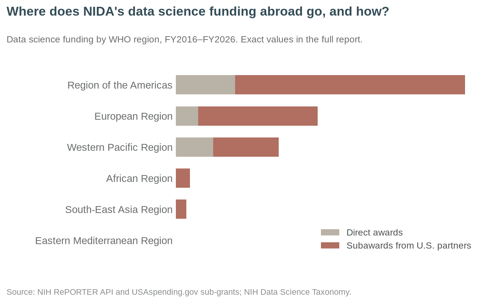

# Where does NIDA fund data science abroad?

**Laura Ellis** · [LinkedIn](https://www.linkedin.com/in/laura-ellis-profile/) · FY2016 to FY2026 · [All 10 institutes](README.md) · [Institute profile](../institutes/nida.md)

The National Institute on Drug Abuse supports data science research outside the United States in two ways: direct awards to foreign organizations, and subawards that its U.S. grantees pass to foreign partners. I traced both.

## What I found

- **U.S. partners carry 79% of NIDA's data science funding abroad.** The report shows which partners, in which countries.
- **NIDA supports data science in 26 countries outside the United States, some of them only through U.S. partners.** The largest share goes to the WHO Region of the Americas; the report maps every country.
- **NIDA's direct foreign awards are about as often data science as its projects at home.** The report shows how that has changed since FY2016.

## Two ways NIH funding reaches partners abroad

1. **Direct awards.** NIH grants to organizations outside the United States (NIH RePORTER).
2. **Subawards.** Money a U.S. grantee passes to a foreign partner, reported to USAspending.gov and linked back to the NIH project.

## The full report

The full NIDA report (8 slides) maps every country, splits each region into direct awards and subawards, names the U.S. partners and foreign institutions that carry the most data science work, compares data science abroad with the institute at home over time, and explains the methods. It's internal; [message me on LinkedIn](https://www.linkedin.com/in/laura-ellis-profile/) if you'd like to see it.

## How the methods work, in plain terms

- **Subawards:** USAspending.gov sub-grants, linked to NIH projects by award number. Only subawards of $30,000 or more must be reported, so totals are a floor.
- **Regions:** World Health Organization (WHO) regions.
- **Data science labels:** keyword rules, then two large language models, decide whether data science is central to a project ([NIH Data Science Taxonomy](../../METHODOLOGY.md)). A subaward counts when its NIH project is data science.
