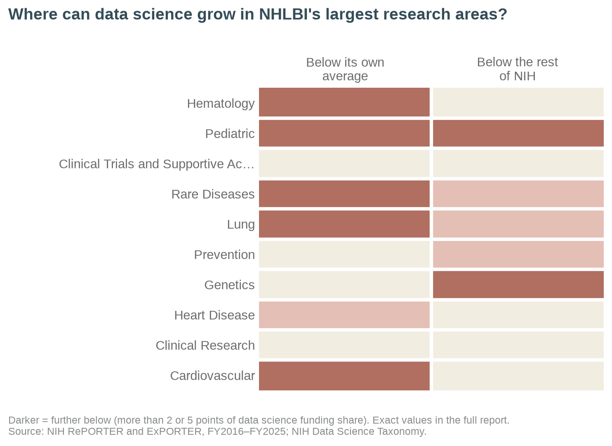

# Where is data science thin at NHLBI?

**Laura Ellis** · [LinkedIn](https://www.linkedin.com/in/laura-ellis-profile/) · FY2016 to FY2025 · [All 10 institutes](README.md) · [Institute profile](../institutes/nhlbi.md)

Data science projects got 27% of funding at the National Heart, Lung, and Blood Institute from FY2016 to FY2025. I looked for the places where data science is thin: compared with NHLBI's own research areas and with the burden of the diseases it funds.

## What I found

- **Data science trails both NHLBI's own average and the rest of NIH in 22 of its research areas, including one of its five largest.** Which ones, and by how much, is in the report.
- **Some of the highest-burden diseases NHLBI funds get less data science there than elsewhere at NIH.** The report names them and sets each against U.S. disability-adjusted life years.
- **New NOFOs that ask for data science come before more data science projects, but not only because of the NOFO.** The report shows how much, and what else was going on.

## Two ways to see a gap

1. **Against its own research areas.** In which areas is data science thinner than the institute's own average, and thinner than at the rest of NIH?
2. **Against disease burden.** Which high-burden diseases get less data science here than at the rest of NIH?

## The full report

The full NHLBI report (13 slides) names the areas and diseases, and adds how data science projects came in (targeted vs. broad NOFOs), whether new NOFOs draw projects in (an event study), which levers go with more highly cited papers, patents, and clinical trials, and an appendix on methods compared with the rest of NIH. It's internal; [message me on LinkedIn](https://www.linkedin.com/in/laura-ellis-profile/) if you'd like to see it.

## How the methods work, in plain terms

- **Gaps:** no model. The share of funding that goes to data science in an area or disease, compared with a benchmark.
- **Disease burden:** each disease is matched to NIH's own categories, then compared with how much healthy life it costs Americans each year (GBD 2023).
- **Data science labels:** keyword rules, then two large language models, decide whether data science is central to a project ([NIH Data Science Taxonomy](../../METHODOLOGY.md)).
