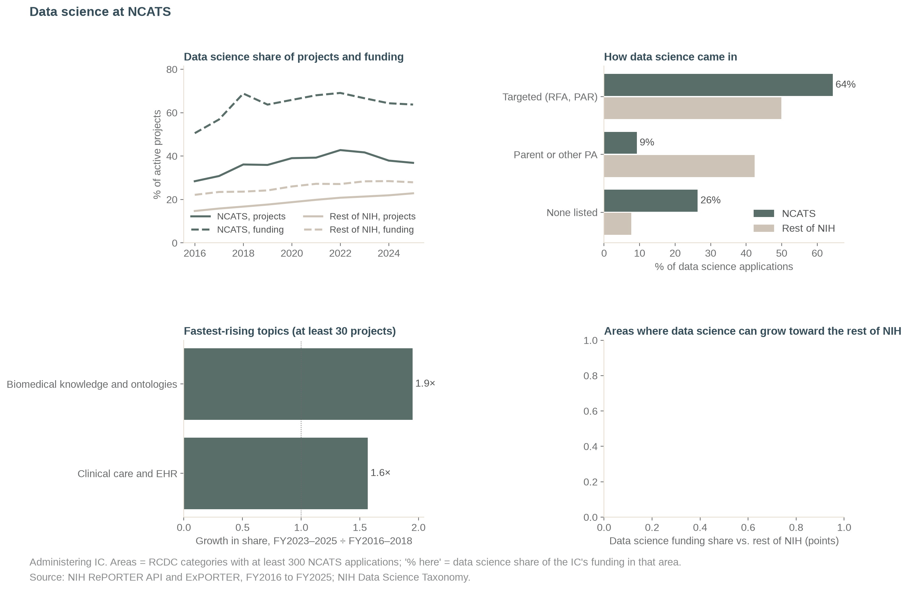

# Data science at the National Center for Advancing Translational Sciences (NCATS)

**Laura Ellis** · [LinkedIn](https://www.linkedin.com/in/laura-ellis-profile/) · [GitHub](https://github.com/Laura-Ellis/nih-ds-taxonomy) · FY2016 to FY2025, administering IC · [All institutes](README.md) · [Presentation (PDF)](https://laura-ellis.github.io/pdf/data_science_at_each_nih_institute.pdf)

NCATS funded 578 data science projects from FY2016 to FY2025. In FY2023 to FY2025, 39% of its projects used data science, compared with 22% for the rest of NIH. By funding, data science was 65% of its dollars, compared with 28% for the rest of NIH. Funding shares run higher because data science projects tend to be larger awards.

Its share grew 1.2 times since FY2016 to FY2018; the rest of NIH grew 1.4 times.

Terms are defined in the [glossary](#glossary) at the end.

## How data science came in

Most projects answer a NOFO (notice of funding opportunity). Targeted NOFOs (RFAs and PARs) ask for work in an area; broad NOFOs (PAs), such as the parent R01, let the researcher pick the topic.

| Route | NCATS | Rest of NIH |
|---|---:|---:|
| Targeted (RFA, PAR) | 64% | 50% |
| Parent or other PA | 9% | 42% |
| None listed | 26% | 8% |

| Activity group | NCATS | Rest of NIH |
|---|---:|---:|
| R01-type | 1% | 30% |
| Other R | 8% | 15% |
| Cooperative (U) | 44% | 15% |
| Centers (P) | 0% | 17% |
| Training (K, F, T) | 22% | 14% |
| Other | 25% | 8% |

### Linking projects to NOFOs

Every grant record names the NOFO (notice of funding opportunity) it answered. For researcher-initiated projects, which name only a broad NOFO such as the parent R01, a ranking model found the targeted NOFO each fits best ([how](../topics/topics_analysis.md#linking-every-project-to-a-nofo)). Weak fit = no targeted NOFO comes close, so that data science came in without a NOFO that asked for it. Shares of data science projects.

| NOFO on the grant record | NCATS | All NIH |
|---|---:|---:|
| Targeted NOFO (RFA, PAR) | 70% | 53% |
| Researcher-initiated, strong fit | 0% | 4% |
| Researcher-initiated, weak fit | 12% | 37% |
| Not through a NOFO (intramural, VA, contract) | 19% | 5% |

NCATS is the main institute for 80 data science PIs. 10% had NIH projects before their first data science project. 71% have projects at more than one institute.

Data science PIs by when they started data science: FY2016–18 or earlier 50, FY2019–21 17, FY2022–25 12. FY2016 is the first year in the data, so earlier starts count there.

## What it works on

Largest themes, FY2023 to FY2025 (share of the IC's data science projects): Training and workforce (49%); Drug discovery and pharmacology (14%); Research cores, centers, and data resources (9%); Clinical care and population health (6%); Genomics and gene regulation (5%); Infectious disease (2%).

Fastest-rising topics: Biomedical knowledge and ontologies (1.9×); Clinical care and EHR (1.6×).

## Where it could do more

These research areas are where NCATS puts a smaller share of its funding into data science than the rest of NIH does in the same area. Areas come from NIH's RCDC categories; each has at least 300 NCATS applications.

| Area | NCATS data science share of funding | Rest of NIH | Difference (points) |
|---|---:|---:|---:|

Where it leads: Clinical Trials and Supportive Activities (+49.2); Clinical Research (+40.9); Translational Research (+40.5).

Kinds of data science NCATS funds least often compared with the rest of NIH (1 = as often, 0.5 = half as often): medical imaging (0.26); neuroscience (0.30); statistical methods (0.34); computer vision (0.40); deep learning (0.45).

## Method and limits

Projects are counted once per fiscal year they are active; the administering IC gets the whole project. Data science = the taxonomy's substantive data science label. RCDC categories overlap. Area gaps compare the IC with all other ICs in the same area and don't account for differences in mission. Counts under 11 are suppressed. Code: `analyses/institutes/ic_profiles.py`; tables in `reports/results/institutes/ncats/`.

**Source:** NIH RePORTER API and ExPORTER, FY2016 to FY2025; NIH Data Science Taxonomy.

## Glossary

| Term | Meaning |
|---|---|
| Activity group | The kind of award: R01-type research grants, other R grants, cooperative agreements (U), centers (P), training (K, F, T) |
| Administering institute | The NIH institute or center that manages a project |
| Data science project | An NIH project whose aims or approach rely on data science, per the NIH Data Science Taxonomy |
| Data science PI | A PI with 2 or more project records, more than half with substantive data science |
| Growth | Data science share in FY2023–25 ÷ share in FY2016–18 |
| NOFO | Notice of funding opportunity: NIH's public request for grant proposals. RFA and PAR = targeted (NIH asks for a topic); PA = broad, such as the parent R01 (the researcher picks) |
| PI | Principal investigator: a person who leads an NIH-funded project |
| RCDC | NIH's research, condition, and disease categories, used to tag every project |
| Rest of NIH | Every other NIH institute and center |

## How the methods work, in plain terms

- **Counts and shares, no model.** Each project counts once in every year it's active, under the institute that manages it. Data science share = data science projects ÷ all projects; growth = share now ÷ share in FY2016–18.
- **Data science labels.** Projects are tagged by the NIH Data Science Taxonomy: keyword rules first, then two large language models (AI systems that read text) that decide whether data science is central to the project.
- **Themes and rising topics.** A topic-grouping method (BERTopic) sorts project summaries into groups that share meaning, like sorting mail by subject when nothing is labeled.
- **Area gaps.** For each research area, the institute's data science share of funding minus the rest of NIH's share in the same area. Negative means the institute does less data science there.
- **NOFO links.** A ranking model (LightGBM LambdaMART) looks at 150 candidate NOFOs for each project and sorts them so the best fit comes first. It's built from 300 small decision trees, each a short chain of yes-or-no questions ("Does the NOFO allow this grant type?"), and it finds a project's actual NOFO in the top 10 for 95% of projects whose NOFO we know.
