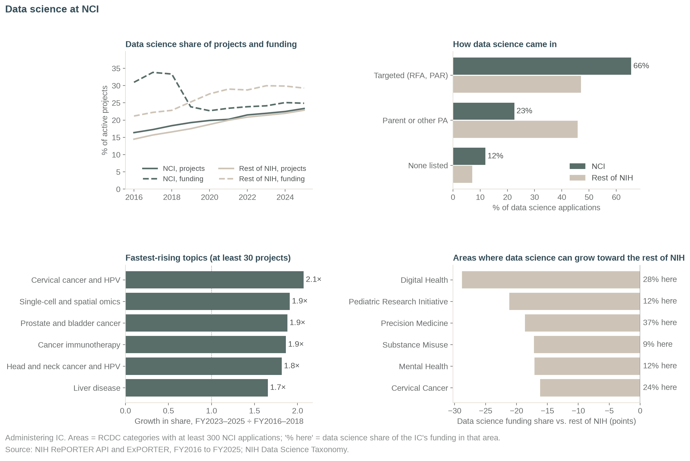

# Data science at the National Cancer Institute (NCI)

**Laura Ellis** · [LinkedIn](https://www.linkedin.com/in/laura-ellis-profile/) · [GitHub](https://github.com/Laura-Ellis/nih-ds-taxonomy) · FY2016 to FY2025, administering IC · [All institutes](README.md)

NCI funded 7,121 data science projects from FY2016 to FY2025. In FY2023 to FY2025, 23% of its projects used data science, compared with 22% for the rest of NIH. By funding, data science was 25% of its dollars, compared with 30% for the rest of NIH. Funding shares run higher because data science projects tend to be larger awards.

Its share grew 1.3 times since FY2016 to FY2018; the rest of NIH grew 1.4 times.

Terms are defined in the [glossary](#glossary) at the end.

## How data science came in

Most projects answer a funding call. Targeted calls (RFAs and PARs) ask for work in an area; broad calls (PAs), such as the parent R01, don't.

| Route | NCI | Rest of NIH |
|---|---:|---:|
| Targeted (RFA, PAR) | 66% | 47% |
| Parent or other PA | 23% | 46% |
| None listed | 12% | 7% |

| Activity group | NCI | Rest of NIH |
|---|---:|---:|
| R01-type | 18% | 32% |
| Other R | 8% | 16% |
| Cooperative (U) | 22% | 14% |
| Centers (P) | 31% | 14% |
| Training (K, F, T) | 8% | 16% |
| Other | 12% | 8% |

### Linking projects to calls

Every grant record names the funding call it answered. For projects that name only a broad call, a ranking model found the targeted call each fits best ([how](../topics/topics_analysis.md#linking-every-project-to-a-call)). Weak fit = no targeted call comes close, so that data science came in without a call that asked for it. Shares of data science projects.

| Call on the grant record | NCI | All NIH |
|---|---:|---:|
| Targeted call on record | 71% | 53% |
| Broad call, strong fit | 3% | 4% |
| Broad call, weak fit | 19% | 37% |
| No funding call (intramural, VA, contract) | 6% | 5% |

Targeted calls its broad-call projects fit best (strong fits, 11 or more projects): PAR-22-131 (Imaging, Biomarkers and Digital Pathomics for the Early Detection of Premetastat, 30); PAR-17-331 (Discovery of Small Molecule Immunomodulators for Cancer Therapy (R01), 29); PAR-21-290 (Integration of Imaging and Fluid-Based Tumor Monitoring in Cancer Therapy (R01 C, 16).

NCI is the main institute for 999 data science PIs. 14% had NIH projects before their first data science project. 42% have projects at more than one institute.

Data science PIs by when they started data science: FY2016–18 or earlier 576, FY2019–21 255, FY2022–25 162. FY2016 is the first year in the data, so earlier starts count there.

## What it works on

Largest themes, FY2023 to FY2025 (share of the IC's data science projects): Research cores, centers, and data resources (29%); Cancer biology and treatment (28%); Cancer screening and risk (10%); Imaging (8%); Training and workforce (4%); Genomics and gene regulation (4%).

Fastest-rising topics: Cervical cancer and HPV (2.1×); Single-cell and spatial omics (1.9×); Prostate and bladder cancer (1.9×); Cancer immunotherapy (1.9×); Head and neck cancer and HPV (1.8×); Liver disease (1.7×).

## Where it could do more

These research areas are where NCI puts a smaller share of its funding into data science than the rest of NIH does in the same area. Areas come from NIH's RCDC categories; each has at least 300 NCI applications.

| Area | NCI data science share of funding | Rest of NIH | Difference (points) |
|---|---:|---:|---:|
| Digital Health | 28% | 57% | -28.8 |
| Pediatric Research Initiative | 12% | 33% | -21.2 |
| Precision Medicine | 37% | 56% | -18.6 |
| Substance Misuse | 9% | 26% | -17.2 |
| Mental Health | 12% | 29% | -17.1 |

Where it leads: Brain Cancer (+11.9); Regenerative Medicine (+6.9); Tobacco Smoke and Health (+6.0).

Kinds of data science NCI funds least often compared with the rest of NIH (1 = as often, 0.5 = half as often): neuroscience (0.06); mental behavioral (0.14); sensors wearables (0.40); network analysis (0.56); nlp (0.61).

## Method and limits

Projects are counted once per fiscal year they are active; the administering IC gets the whole project. Data science = the taxonomy's substantive data science label. RCDC categories overlap. Area gaps compare the IC with all other ICs in the same area and don't account for differences in mission. Counts under 11 are suppressed. Code: `analyses/institutes/ic_profiles.py`; tables in `reports/results/institutes/nci/`.

**Source:** NIH RePORTER API and ExPORTER, FY2016 to FY2025; NIH Data Science Taxonomy.

## Glossary

| Term | Meaning |
|---|---|
| Activity group | The kind of award: R01-type research grants, other R grants, cooperative agreements (U), centers (P), training (K, F, T) |
| Administering institute | The NIH institute or center that manages a project |
| Data science project | An NIH project whose aims or approach rely on data science, per the NIH Data Science Taxonomy |
| Data science PI | A PI with 2 or more project records, more than half with substantive data science |
| Growth | Data science share in FY2023–25 ÷ share in FY2016–18 |
| NOFO | Notice of funding opportunity. RFA and PAR = targeted calls for an area; PA = broad, such as the parent R01 |
| PI | Principal investigator: a person who leads an NIH-funded project |
| RCDC | NIH's research, condition, and disease categories, used to tag every project |
| Rest of NIH | Every other NIH institute and center |

## How the methods work, in plain terms

- **Counts and shares, no model.** Each project counts once in every year it's active, under the institute that manages it. Data science share = data science projects ÷ all projects; growth = share now ÷ share in FY2016–18.
- **Data science labels.** Projects are tagged by the NIH Data Science Taxonomy: keyword rules first, then two large language models (AI systems that read text) that decide whether data science is central to the project.
- **Themes and rising topics.** A topic-grouping method (BERTopic) sorts project summaries into groups that share meaning, like sorting mail by subject when nothing is labeled.
- **Area gaps.** For each research area, the institute's data science share of funding minus the rest of NIH's share in the same area. Negative means the institute does less data science there.
- **Call links.** A ranking model (LightGBM LambdaMART) looks at 150 candidate calls for each project and sorts them so the best fit comes first. It's built from 300 small decision trees, each a short chain of yes-or-no questions ("Does the call allow this grant type?"), and it finds a project's actual call in the top 10 for 95% of projects whose call we know.
