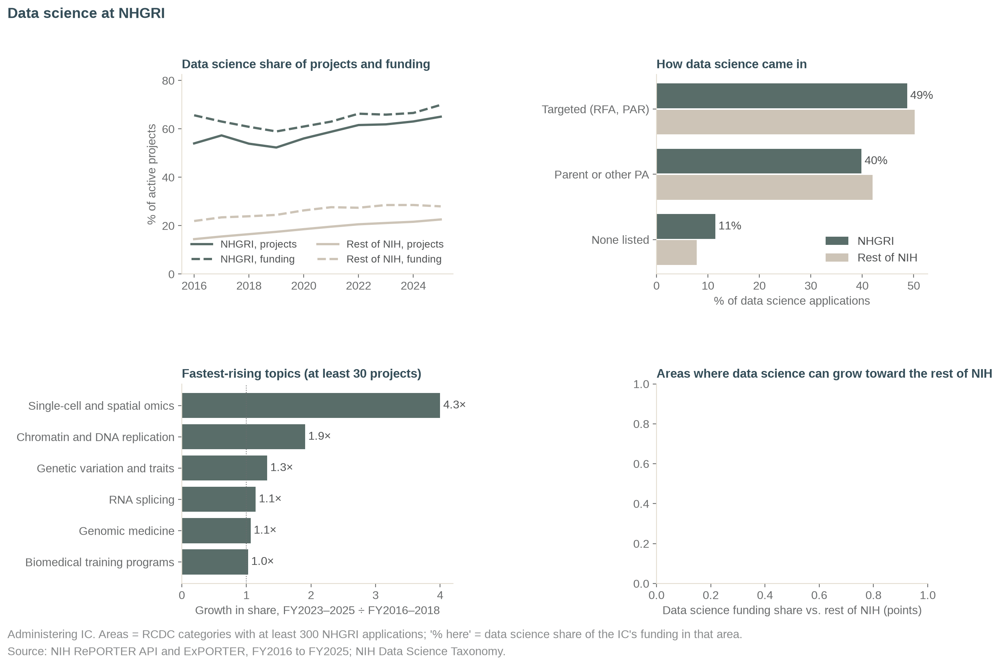

# Data science at the National Human Genome Research Institute (NHGRI)

**Laura Ellis** · [LinkedIn](https://www.linkedin.com/in/laura-ellis-profile/) · [GitHub](https://github.com/Laura-Ellis/nih-ds-taxonomy) · FY2016 to FY2025, administering IC · [All institutes](README.md)

NHGRI funded 1,165 data science projects from FY2016 to FY2025. In FY2023 to FY2025, 63% of its projects used data science, compared with 22% for the rest of NIH. By funding, data science was 67% of its dollars, compared with 28% for the rest of NIH. Funding shares run higher because data science projects tend to be larger awards.

Its share grew 1.2 times since FY2016 to FY2018; the rest of NIH grew 1.4 times.

Terms are defined in the [glossary](#glossary) at the end.

## How data science came in

Most projects answer a funding call. Targeted calls (RFAs and PARs) ask for work in an area; broad calls (PAs), such as the parent R01, don't.

| Route | NHGRI | Rest of NIH |
|---|---:|---:|
| Targeted (RFA, PAR) | 49% | 50% |
| Parent or other PA | 40% | 42% |
| None listed | 11% | 8% |

| Activity group | NHGRI | Rest of NIH |
|---|---:|---:|
| R01-type | 25% | 30% |
| Other R | 18% | 15% |
| Cooperative (U) | 34% | 15% |
| Centers (P) | 0% | 17% |
| Training (K, F, T) | 11% | 14% |
| Other | 12% | 9% |

NHGRI is the main institute for 257 data science PIs. 9% had NIH projects before their first data science project. 69% have projects at more than one institute.

Data science PIs by when they started data science: FY2016–18 or earlier 175, FY2019–21 41, FY2022–25 40. FY2016 is the first year in the data, so earlier starts count there.

## What it works on

Largest themes, FY2023 to FY2025 (share of the IC's data science projects): Genomics and gene regulation (58%); Research cores, centers, and data resources (11%); Training and workforce (9%); Single-cell and spatial omics (8%); Heart, lung, kidney, and liver (2%); Mental health and substance use (2%).

Fastest-rising topics: Single-cell and spatial omics (4.3×); Chromatin and DNA replication (1.9×); Genetic variation and traits (1.3×); RNA splicing (1.1×); Genomic medicine (1.1×); Biomedical training programs (1.0×).

## Where it could do more

These research areas are where NHGRI puts a smaller share of its funding into data science than the rest of NIH does in the same area. Areas come from NIH's RCDC categories; each has at least 300 NHGRI applications.

| Area | NHGRI data science share of funding | Rest of NIH | Difference (points) |
|---|---:|---:|---:|

Where it leads: Prevention (+34.6); Genetics (+34.4); Clinical Research (+21.3).

Kinds of data science NHGRI funds least often compared with the rest of NIH (1 = as often, 0.5 = half as often): sensors wearables (0.14); medical imaging (0.20); human data linkage (0.21); neuroscience (0.27); computer vision (0.35).

## Method and limits

Projects are counted once per fiscal year they are active; the administering IC gets the whole project. Data science = the taxonomy's substantive data science label. RCDC categories overlap. Area gaps compare the IC with all other ICs in the same area and don't account for differences in mission. Counts under 11 are suppressed. Code: `analyses/institutes/ic_profiles.py`; tables in `reports/results/institutes/nhgri/`.

**Source:** NIH RePORTER API and ExPORTER, FY2016 to FY2025; NIH Data Science Taxonomy.

## Glossary

| Term | Meaning |
|---|---|
| Activity group | The kind of award: R01-type research grants, other R grants, cooperative agreements (U), centers (P), training (K, F, T) |
| Administering institute | The NIH institute or center that manages a project |
| Data science project | An NIH project whose aims or approach rely on data science, per the NIH Data Science Taxonomy |
| Data science PI | A PI with 2 or more project records, more than half with substantive data science |
| Growth | Data science share in FY2023–25 ÷ share in FY2016–18 |
| NOFO | Notice of funding opportunity. RFA and PAR = targeted calls for an area; PA = broad, such as the parent R01 |
| PI | Principal investigator: a person who leads an NIH-funded project |
| RCDC | NIH's research, condition, and disease categories, used to tag every project |
| Rest of NIH | Every other NIH institute and center |
