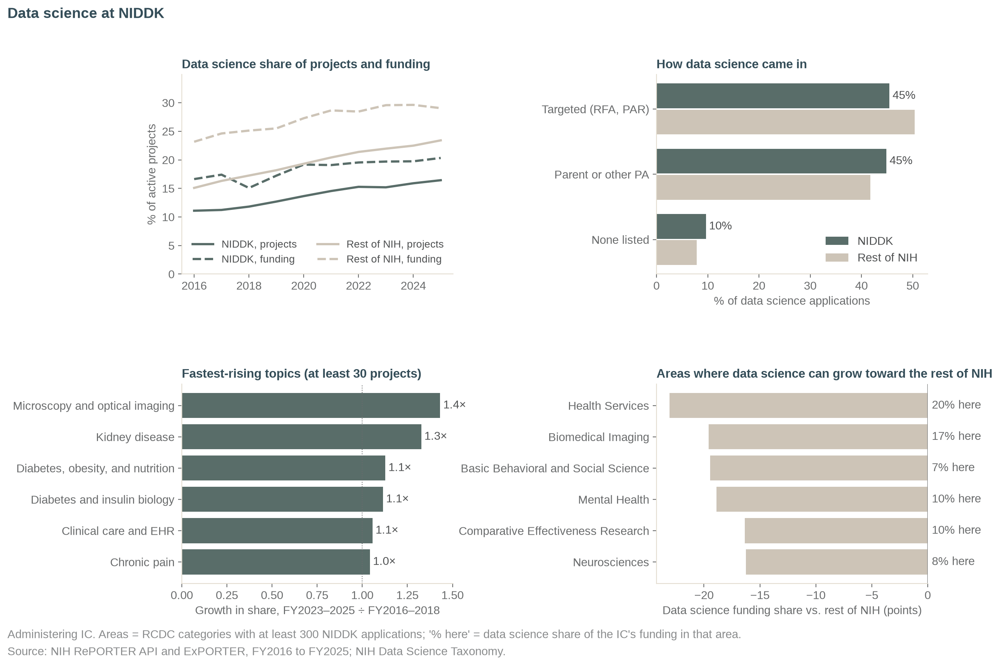

# Data science at the National Institute of Diabetes and Digestive and Kidney Diseases (NIDDK)

**Laura Ellis** · [LinkedIn](https://www.linkedin.com/in/laura-ellis-profile/) · [GitHub](https://github.com/Laura-Ellis/nih-ds-taxonomy) · FY2016 to FY2025, administering IC · [All institutes](README.md) · [Presentation (PDF)](https://laura-ellis.github.io/pdf/data_science_at_each_nih_institute.pdf)

NIDDK funded 1,908 data science projects from FY2016 to FY2025. In FY2023 to FY2025, 16% of its projects used data science, compared with 23% for the rest of NIH. By funding, data science was 20% of its dollars, compared with 29% for the rest of NIH. Funding shares run higher because data science projects tend to be larger awards.

Its share grew 1.4 times since FY2016 to FY2018; the rest of NIH grew 1.4 times.

Terms are defined in the [glossary](#glossary) at the end.

## How data science came in

Most projects answer a NOFO (notice of funding opportunity). Targeted NOFOs (RFAs and PARs) ask for work in an area; broad NOFOs (PAs), such as the parent R01, let the researcher pick the topic.

| Route | NIDDK | Rest of NIH |
|---|---:|---:|
| Targeted (RFA, PAR) | 45% | 50% |
| Parent or other PA | 45% | 42% |
| None listed | 10% | 8% |

| Activity group | NIDDK | Rest of NIH |
|---|---:|---:|
| R01-type | 28% | 30% |
| Other R | 6% | 15% |
| Cooperative (U) | 21% | 15% |
| Centers (P) | 16% | 17% |
| Training (K, F, T) | 18% | 14% |
| Other | 10% | 9% |

### Linking projects to NOFOs

Every grant record names the NOFO (notice of funding opportunity) it answered. For researcher-initiated projects, which name only a broad NOFO such as the parent R01, a ranking model found the targeted NOFO each fits best ([how](../topics/topics_analysis.md#linking-every-project-to-a-nofo)). Weak fit = no targeted NOFO comes close, so that data science came in without a NOFO that asked for it. Shares of data science projects.

| NOFO on the grant record | NIDDK | All NIH |
|---|---:|---:|
| Targeted NOFO (RFA, PAR) | 48% | 53% |
| Researcher-initiated, strong fit | 4% | 4% |
| Researcher-initiated, weak fit | 44% | 37% |
| Not through a NOFO (intramural, VA, contract) | 4% | 5% |

Targeted NOFOs its researcher-initiated projects fit best (strong fits, 11 or more projects): PAR-13-293 (Gut Microbiota-Derived Factors in the Integrated Physiology and Pathophysiology , 17); PAR-21-253 (Identification and Characterization of Bioactive Microbial Metabolites for Advan, 13); RFA-DK-17-023 (Clinical, Behavioral and Physiological Research Testing Current and Novel Closed, 13).

NIDDK is the main institute for 233 data science PIs. 9% had NIH projects before their first data science project. 60% have projects at more than one institute.

Data science PIs by when they started data science: FY2016–18 or earlier 134, FY2019–21 61, FY2022–25 35. FY2016 is the first year in the data, so earlier starts count there.

## What it works on

Largest themes, FY2023 to FY2025 (share of the IC's data science projects): Metabolism, microbiome, and gut (28%); Heart, lung, kidney, and liver (28%); Clinical care and population health (16%); Research cores, centers, and data resources (3%); Proteins, structure, and chemistry (3%); Musculoskeletal, pain, and rehabilitation (3%).

Fastest-rising topics: Microscopy and optical imaging (1.4×); Kidney disease (1.3×); Diabetes, obesity, and nutrition (1.1×); Diabetes and insulin biology (1.1×); Clinical care and EHR (1.1×); Chronic pain (1.0×).

## Where it can grow next

These research areas are where NIDDK puts a smaller share of its funding into data science than the rest of NIH does in the same area. Areas come from NIH's RCDC categories; each has at least 300 NIDDK applications.

| Area | NIDDK data science share of funding | Rest of NIH | Difference (points) |
|---|---:|---:|---:|
| Health Services | 20% | 43% | -23.1 |
| Biomedical Imaging | 17% | 36% | -19.6 |
| Basic Behavioral and Social Science | 7% | 27% | -19.4 |
| Mental Health | 10% | 29% | -18.9 |
| Comparative Effectiveness Research | 10% | 27% | -16.3 |

Where it leads: Autoimmune Disease (+7.9); Crohn's Disease (+6.4); Stem Cell Research - Nonembryonic - Non-Human (+6.3).

Kinds of data science NIDDK funds least often compared with the rest of NIH (1 = as often, 0.5 = half as often): mental behavioral (0.17); neuroscience (0.18); generative ai (0.30); community capacity (0.35); nlp (0.40).

## Method and limits

Projects are counted once per fiscal year they are active; the administering IC gets the whole project. Data science = the taxonomy's substantive data science label. RCDC categories overlap. Area opportunities compare the IC with all other ICs in the same area and don't account for differences in mission. Counts under 11 are suppressed. Code: `analyses/institutes/ic_profiles.py`; tables in `reports/results/institutes/niddk/`.

**Source:** NIH RePORTER API and ExPORTER, FY2016 to FY2025; NIH Data Science Taxonomy.

## Glossary

| Term | Meaning |
|---|---|
| Activity group | The kind of award: R01-type research grants, other R grants, cooperative agreements (U), centers (P), training (K, F, T) |
| Administering institute | The NIH institute or center that manages a project |
| Data science project | An NIH project whose aims or approach rely on data science, per the NIH Data Science Taxonomy |
| Data science PI | A PI with 2 or more project records, more than half with substantive data science |
| Growth | Data science share in FY2023–25 ÷ share in FY2016–18 |
| NOFO | Notice of funding opportunity: NIH's public request for grant proposals. RFA and PAR = targeted (NIH asks for a topic); PA = broad, such as the parent R01 (the researcher picks) |
| PI | Principal investigator: a person who leads an NIH-funded project |
| RCDC | NIH's research, condition, and disease categories, used to tag every project |
| Rest of NIH | Every other NIH institute and center |

## How the methods work, in plain terms

- **Counts and shares, no model.** Each project counts once in every year it's active, under the institute that manages it. Data science share = data science projects ÷ all projects; growth = share now ÷ share in FY2016–18.
- **Data science labels.** Projects are tagged by the NIH Data Science Taxonomy: keyword rules first, then two large language models (AI systems that read text) that decide whether data science is central to the project.
- **Themes and rising topics.** A topic-grouping method (BERTopic) sorts project summaries into groups that share meaning, like sorting mail by subject when nothing is labeled.
- **Area opportunities.** For each research area, the institute's data science share of funding minus the rest of NIH's share in the same area. Negative means room to grow there.
- **NOFO links.** A ranking model (LightGBM LambdaMART) looks at 150 candidate NOFOs for each project and sorts them so the best fit comes first. It's built from 300 small decision trees, each a short chain of yes-or-no questions ("Does the NOFO allow this grant type?"), and it finds a project's actual NOFO in the top 10 for 95% of projects whose NOFO we know.
