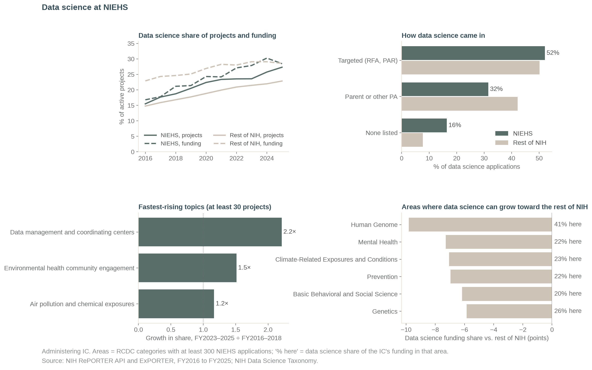

# Data science at the National Institute of Environmental Health Sciences (NIEHS)

**Laura Ellis** · [LinkedIn](https://www.linkedin.com/in/laura-ellis-profile/) · [GitHub](https://github.com/Laura-Ellis/nih-ds-taxonomy) · FY2016 to FY2025, administering IC · [All institutes](README.md)

NIEHS funded 1,099 data science projects from FY2016 to FY2025. In FY2023 to FY2025, 26% of its projects used data science, compared with 22% for the rest of NIH. By funding, data science was 29% of its dollars, compared with 29% for the rest of NIH. Funding shares run higher because data science projects tend to be larger awards.

Its share grew 1.5 times since FY2016 to FY2018; the rest of NIH grew 1.4 times.

Terms are defined in the [glossary](#glossary) at the end.

## How data science came in

Most projects answer a funding call. Targeted calls (RFAs and PARs) ask for work in an area; broad calls (PAs), such as the parent R01, don't.

| Route | NIEHS | Rest of NIH |
|---|---:|---:|
| Targeted (RFA, PAR) | 52% | 50% |
| Parent or other PA | 32% | 42% |
| None listed | 16% | 8% |

| Activity group | NIEHS | Rest of NIH |
|---|---:|---:|
| R01-type | 17% | 30% |
| Other R | 13% | 15% |
| Cooperative (U) | 7% | 16% |
| Centers (P) | 33% | 16% |
| Training (K, F, T) | 13% | 14% |
| Other | 17% | 9% |

NIEHS is the main institute for 166 data science PIs. 12% had NIH projects before their first data science project. 51% have projects at more than one institute.

Data science PIs by when they started data science: FY2016–18 or earlier 74, FY2019–21 39, FY2022–25 53. FY2016 is the first year in the data, so earlier starts count there.

## What it works on

Largest themes, FY2023 to FY2025 (share of the IC's data science projects): Environmental health (56%); Research cores, centers, and data resources (12%); Training and workforce (4%); Proteins, structure, and chemistry (4%); Genomics and gene regulation (4%); Heart, lung, kidney, and liver (4%).

Fastest-rising topics: Data management and coordinating centers (2.2×); Environmental health community engagement (1.5×); Air pollution and chemical exposures (1.2×).

## Where it could do more

These research areas are where NIEHS puts a smaller share of its funding into data science than the rest of NIH does in the same area. Areas come from NIH's RCDC categories; each has at least 300 NIEHS applications.

| Area | NIEHS data science share of funding | Rest of NIH | Difference (points) |
|---|---:|---:|---:|
| Human Genome | 41% | 51% | -9.8 |
| Mental Health | 22% | 29% | -7.3 |
| Climate-Related Exposures and Conditions | 23% | 30% | -7.1 |
| Prevention | 22% | 29% | -7.0 |
| Basic Behavioral and Social Science | 20% | 26% | -6.2 |

Where it leads: Foodborne Illness (+15.1); Endocrine Disruptors (+3.3); Perinatal Period - Conditions Originating in Perinatal Period (+3.0).

Kinds of data science NIEHS funds least often compared with the rest of NIH (1 = as often, 0.5 = half as often): medical imaging (0.25); computer vision (0.29); generative ai (0.30); deep learning (0.39); clinical care (0.41).

## Method and limits

Projects are counted once per fiscal year they are active; the administering IC gets the whole project. Data science = the taxonomy's substantive data science label. RCDC categories overlap. Area gaps compare the IC with all other ICs in the same area and don't account for differences in mission. Counts under 11 are suppressed. Code: `analyses/institutes/ic_profiles.py`; tables in `reports/results/institutes/niehs/`.

**Source:** NIH RePORTER API and ExPORTER, FY2016 to FY2025; NIH Data Science Taxonomy.

## Glossary

| Term | Meaning |
|---|---|
| Activity group | The kind of award: R01-type research grants, other R grants, cooperative agreements (U), centers (P), training (K, F, T) |
| Administering institute | The NIH institute or center that manages a project |
| Data science project | An NIH project whose aims or approach rely on data science, per the NIH Data Science Taxonomy |
| Data science PI | A PI with 2 or more project records, more than half with substantive data science |
| Growth | Data science share in FY2023–25 ÷ share in FY2016–18 |
| NOFO | Notice of funding opportunity. RFA and PAR = targeted calls for an area; PA = broad, such as the parent R01 |
| PI | Principal investigator: a person who leads an NIH-funded project |
| RCDC | NIH's research, condition, and disease categories, used to tag every project |
| Rest of NIH | Every other NIH institute and center |
