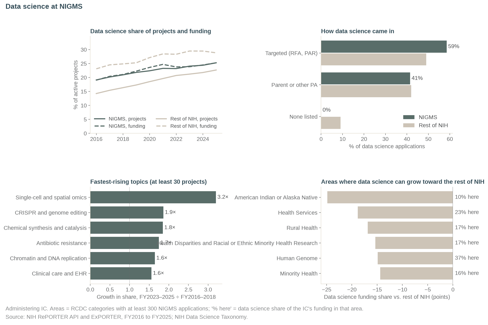

# Data science at the National Institute of General Medical Sciences (NIGMS)

**Laura Ellis** · [LinkedIn](https://www.linkedin.com/in/laura-ellis-profile/) · [GitHub](https://github.com/Laura-Ellis/nih-ds-taxonomy) · FY2016 to FY2025, administering IC · [All institutes](README.md)

NIGMS funded 5,096 data science projects from FY2016 to FY2025. In FY2023 to FY2025, 25% of its projects used data science, compared with 22% for the rest of NIH. By funding, data science was 25% of its dollars, compared with 29% for the rest of NIH. Funding shares run higher because data science projects tend to be larger awards.

Its share grew 1.2 times since FY2016 to FY2018; the rest of NIH grew 1.4 times.

Terms are defined in the [glossary](#glossary) at the end.

## How data science came in

Most projects answer a funding call. Targeted calls (RFAs and PARs) ask for work in an area; broad calls (PAs), such as the parent R01, don't.

| Route | NIGMS | Rest of NIH |
|---|---:|---:|
| Targeted (RFA, PAR) | 59% | 49% |
| Parent or other PA | 41% | 42% |
| None listed | 0% | 9% |

| Activity group | NIGMS | Rest of NIH |
|---|---:|---:|
| R01-type | 33% | 29% |
| Other R | 35% | 12% |
| Cooperative (U) | 3% | 17% |
| Centers (P) | 18% | 17% |
| Training (K, F, T) | 9% | 15% |
| Other | 1% | 10% |

NIGMS is the main institute for 734 data science PIs. 11% had NIH projects before their first data science project. 61% have projects at more than one institute.

Data science PIs by when they started data science: FY2016–18 or earlier 465, FY2019–21 181, FY2022–25 84. FY2016 is the first year in the data, so earlier starts count there.

## What it works on

Largest themes, FY2023 to FY2025 (share of the IC's data science projects): Proteins, structure, and chemistry (22%); Genomics and gene regulation (19%); Training and workforce (14%); Cell biology and development (7%); Infectious disease (7%); Clinical care and population health (5%).

Fastest-rising topics: Single-cell and spatial omics (3.2×); CRISPR and genome editing (1.9×); Chemical synthesis and catalysis (1.8×); Antibiotic resistance (1.7×); Chromatin and DNA replication (1.6×); Clinical care and EHR (1.6×).

## Where it could do more

These research areas are where NIGMS puts a smaller share of its funding into data science than the rest of NIH does in the same area. Areas come from NIH's RCDC categories; each has at least 300 NIGMS applications.

| Area | NIGMS data science share of funding | Rest of NIH | Difference (points) |
|---|---:|---:|---:|
| American Indian or Alaska Native | 10% | 35% | -24.8 |
| Health Services | 23% | 42% | -18.8 |
| Rural Health | 17% | 34% | -16.9 |
| Health Disparities and Racial or Ethnic Minority Health Research | 17% | 32% | -15.4 |
| Human Genome | 37% | 52% | -14.9 |

Where it leads: Immunization (+16.9); Sepsis (+12.7); Precision Medicine (+10.2).

Kinds of data science NIGMS funds least often compared with the rest of NIH (1 = as often, 0.5 = half as often): sensors wearables (0.16); human data linkage (0.21); mental behavioral (0.25); data management sharing (0.29); neuroscience (0.42).

## Method and limits

Projects are counted once per fiscal year they are active; the administering IC gets the whole project. Data science = the taxonomy's substantive data science label. RCDC categories overlap. Area gaps compare the IC with all other ICs in the same area and don't account for differences in mission. Counts under 11 are suppressed. Code: `analyses/institutes/ic_profiles.py`; tables in `reports/results/institutes/nigms/`.

**Source:** NIH RePORTER API and ExPORTER, FY2016 to FY2025; NIH Data Science Taxonomy.

## Glossary

| Term | Meaning |
|---|---|
| Activity group | The kind of award: R01-type research grants, other R grants, cooperative agreements (U), centers (P), training (K, F, T) |
| Administering institute | The NIH institute or center that manages a project |
| Data science project | An NIH project whose aims or approach rely on data science, per the NIH Data Science Taxonomy |
| Data science PI | A PI with 2 or more project records, more than half with substantive data science |
| Growth | Data science share in FY2023–25 ÷ share in FY2016–18 |
| NOFO | Notice of funding opportunity. RFA and PAR = targeted calls for an area; PA = broad, such as the parent R01 |
| PI | Principal investigator: a person who leads an NIH-funded project |
| RCDC | NIH's research, condition, and disease categories, used to tag every project |
| Rest of NIH | Every other NIH institute and center |
