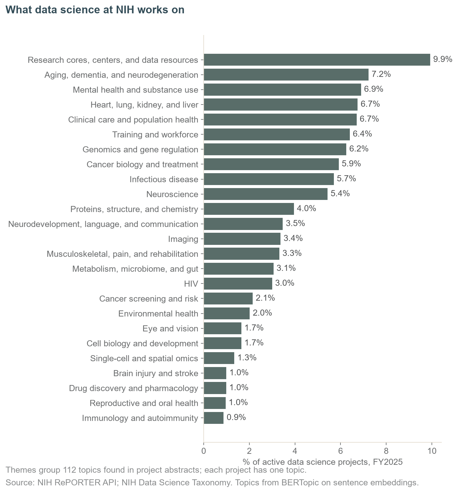
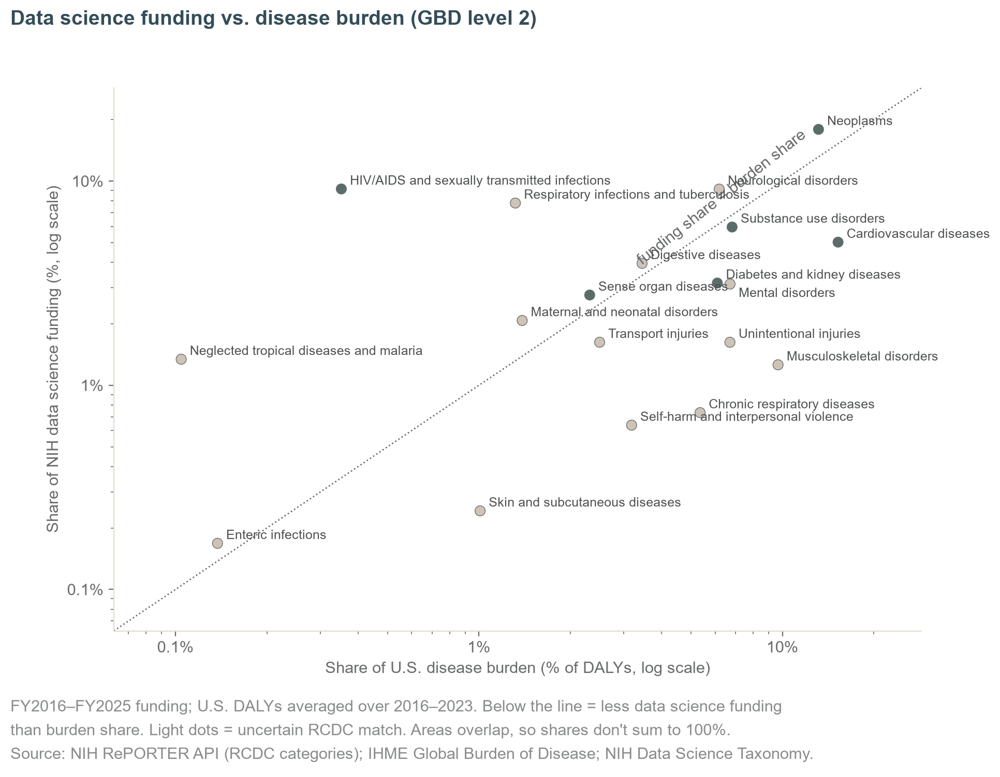
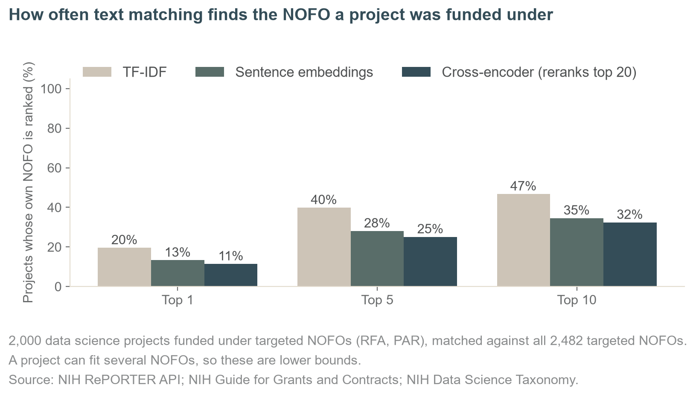
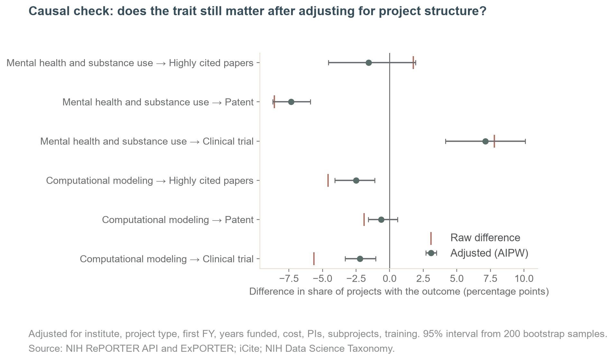

# What data science at NIH works on, where it's growing, and where it's thin

**Laura Ellis** · [GitHub](https://github.com/Laura-Ellis/nih-ds-taxonomy) · Data FY2016 to FY2025 (NIH RePORTER API, as of October 24, 2026)

Most of the growth in NIH data science follows institute priorities: dementia at NIA, opioids at NIDA, cancer at NCI. The exception is single-cell and spatial omics, a method growing across many institutes at once. Relative to U.S. disease burden, data science is thinnest in musculoskeletal, chronic respiratory, and heart disease, the same areas where NIH's overall funding is light and where few targeted funding opportunities match the projects. Funding opportunities that ask for data science fund more of it. Total cost and project type drive outputs far more than any data science trait.

## Contents

1. [What data science works on](#1-what-data-science-works-on)
2. [What's rising](#2-whats-rising)
3. [Where it's thin relative to need](#3-where-its-thin-relative-to-need)
4. [What draws it in](#4-what-draws-it-in)
5. [Matching projects to funding opportunities](#5-matching-projects-to-funding-opportunities)
6. [What goes with patents, trials, and highly cited papers](#6-what-goes-with-patents-trials-and-highly-cited-papers)
7. [What this means](#7-what-this-means)
8. [Method, data, and limits](#8-method-data-and-limits)

## 1. What data science works on

I described the same 45,803 data science projects three ways: LDA topics (20, chosen by UMass coherence from 20, 30, and 40), BERTopic topics (112, named by hand and grouped into 25 themes), and the taxonomy's own groups (statistics, modeling, AI, software, infrastructure, responsible AI, workforce).

Research cores, centers, and data resources is the largest theme in FY2025 (9.9% of active data science projects), then aging and dementia (7.2%), mental health and substance use (6.9%), and heart, lung, kidney, and liver (6.7%).

The topic models and the taxonomy barely agree (normalized mutual information 0.07 for BERTopic, 0.11 for LDA). That's expected: topics sort projects by the disease or system they study, and the taxonomy sorts them by the method they use. The two complement each other. LDA and BERTopic agree in part (0.36); BERTopic splits what LDA lumps together.

## 2. What's rising

A fast riser has a share in FY2023 to FY2025 at least 1.5 times its share in FY2016 to FY2018, a steady rise (Kendall's τ, p < 0.05), and at least 100 projects.

Most fast risers come mainly from one institute: dementia care and caregivers (NIA 94%), Alzheimer's disease (NIA 90%), opioid use and overdose (NIDA 85%), prostate and bladder cancer (NCI 88%), cancer immunotherapy (NCI 76%), and suicide prevention (NIMH 62%). These rises track institute priorities and appropriations, not something specific to data science.

Single-cell and spatial omics (2.3×) is the exception. The largest institute (NIGMS) holds only 32% of it, and it's the only fast riser that is a method rather than a disease.

Charts for every institute with at least 500 data science projects are in [reports/figures/topics/ic](../../reports/figures/topics/ic/).

## 3. Where it's thin relative to need

I compared each cause group's share of U.S. disease burden (DALYs, IHME Global Burden of Disease 2023) with its share of NIH data science funding, FY2016 to FY2025, using a crosswalk from RCDC categories to GBD causes ([rcdc_gbd_crosswalk.csv](rcdc_gbd_crosswalk.csv)).

| Cause group (GBD level 2) | Share of burden | Share of data science funding | Gap ratio |
|---|---:|---:|---:|
| Musculoskeletal disorders | 9.7% | 1.3% | 0.13 |
| Chronic respiratory diseases | 5.4% | 0.7% | 0.14 |
| Cardiovascular diseases | 15.2% | 5.0% | 0.33 |
| Respiratory infections and TB | 1.3% | 8% | 5.9 |
| HIV/AIDS and STIs | 0.4% | 9% | 26 |

Gap ratio = data science funding share ÷ burden share (1.0 = in proportion). Self-harm and violence, unintentional injuries, and skin disease are also low.

Data science mostly mirrors NIH's own funding: musculoskeletal disorders get 1.5% of all NIH funding and cardiovascular disease 6.5%. Relative to NIH's own investment in each area, data science lags most in chronic respiratory, skin, digestive, diabetes and kidney, and cardiovascular disease.

## 4. What draws it in

I downloaded the NIH Guide text for the 2,913 funding opportunities (NOFOs) behind 95% of data science records and found Section I for 2,912. A NOFO asks for data science when the taxonomy's keyword rules find a data science category in Section I, the same rules used on abstracts.

NOFOs that ask for data science fund more of it. Median data science share of funded records: RFAs 23% vs. 19%, PARs 22% vs. 16%, other announcements 22% vs. 14%. Still, most data science comes through parent R01 announcements that never mention it; PA-20-185 alone funded 3,349 data science records.

Some topics have no matching targeted NOFO: few of their projects come through RFAs or PARs, and the closest NOFO text is a loose match. Heart disease (27% through targeted NOFOs), hearing (33%), bone and joint (30%), retina and glaucoma (27%), stroke (30%), and anxiety and depression (27%) are on that list. Heart and musculoskeletal disease are also thin relative to burden, so the same areas lack both funding and calls that ask for data science.

## 5. Matching projects to funding opportunities

Can a model find the NOFO a project was funded under, from its abstract alone? For 2,000 data science projects funded under a targeted NOFO, I ranked all 2,482 targeted NOFOs. The real funding link is the answer key, so no hand coding is needed.

| Method | Top 1 | Top 5 | Top 10 | Mean reciprocal rank |
|---|---:|---:|---:|---:|
| TF-IDF | 20% | 40% | 47% | 0.29 |
| Sentence embeddings (all-MiniLM-L6-v2) | 13% | 28% | 35% | 0.21 |
| Cross-encoder (ms-marco-MiniLM-L-6-v2) | 11% | 25% | 32% | 0.18 |

The simplest method wins. An application and the NOFO it answers share distinctive terms (program names, required elements, disease names) that TF-IDF rewards. The small embedding model reads only the first 256 word pieces, and the cross-encoder was trained on web search queries, not scientific prose. Larger biomedical models are the next test.

## 6. What goes with patents, trials, and highly cited papers

For 15,729 data science projects that started FY2016 to FY2020 (at least five years to produce outputs), I predicted three outcomes from taxonomy groups, AI use and role, research theme, and project structure. Five-fold cross-validated ROC AUC for the best model: clinical trial 0.83, patent 0.80, highly cited paper 0.68. Logistic regression comes within 0.01 to 0.03 of gradient boosting and random forest.

Structure dominates. Total cost is the top driver of all three outcomes (SHAP values). Beyond structure, statistics and analytics goes with highly cited papers, data infrastructure goes against patents, applying AI goes with trials, and computational modeling goes against trials.

A doubly robust check (AIPW, adjusted for structure, 200 bootstrap samples) on the two strongest traits:

- Mental health and substance use: clinical trial +7.1 points (16% vs. 8%), patent −7.3 points (2% vs. 11%), no difference in citations.
- Computational modeling: highly cited −2.5 points, trial −2.2 points.

## 7. What this means

Target the thin areas. Heart, musculoskeletal, and chronic respiratory disease carry large shares of burden, small shares of data science funding, and few calls that ask for it. Calls written for these areas are the most direct lever, though most of the gap reflects NIH's overall funding.

Read rises by institute. Dementia, opioids, and cancer immunotherapy grow with NIA, NIDA, and NCI priorities. Single-cell and spatial omics is the one method growing across institutes, a candidate for shared infrastructure and training.

Judge outputs by area. Mental health projects are more likely to have a trial and less likely to have a patent. Comparing data science projects with others in the same area, type, and size is the fair way to credit them.

## 8. Method, data, and limits

**Data:** 45,803 data science projects with abstracts (NIH Data Science Taxonomy), FY2016 to FY2025, NIH RePORTER API; NIH Guide text for 2,913 NOFOs; IHME GBD 2023 U.S. DALYs, averaged over 2016 to 2023; ExPORTER publication, patent, and clinical study links; iCite Relative Citation Ratio.

**Topics:** LDA (scikit-learn); BERTopic on all-MiniLM-L6-v2 embeddings with UMAP and HDBSCAN. Share = active data science projects whose topic is in the theme ÷ all active data science projects that FY; one topic per project.

**Burden:** GBD level 3 causes summed to level 2. Funding share uses attributed cost of data science records whose RCDC categories match the cause.

**Matching:** NOFO text split into ~200-word chunks, scored by best chunk. Mean reciprocal rank = average of 1 ÷ the rank of the right NOFO. A project can fit more than one NOFO, so these are lower bounds.

**Impact:** highly cited = mean RCR in the top quarter of projects with papers (23% of projects); patent 10%; trial 8%. Logistic regression, random forest, and histogram gradient boosting (scikit-learn); SHAP; AIPW with 200 bootstrap samples.

**Code:** `analyses/topics/topics.py` (topics), `topic_themes.py` (themes and trends), `nofo_match.py` (NOFOs and matching), `gaps.py` (burden), `impact_models.py` (outputs); `src/nofo_pull.py` downloads the NOFO text. Everything runs locally with free, open models.

**Limits:**

- RCDC categories overlap, so shares don't sum to 100%, and 29 of 83 crosswalk matches are medium or low confidence (flagged in the tables).
- Burden is one measure of need. Scientific opportunity, cost, and other funders also matter.
- Citations, patents, and trials lag and depend on what's linked.
- The impact models show associations. Traits not in the data, such as a team's track record, can still explain the differences.

**Sources:** [IHME Global Burden of Disease 2023](https://www.healthdata.org/research-analysis/gbd); [NIH Guide for Grants and Contracts](https://grants.nih.gov/funding/nih-guide-for-grants-and-contracts); [NIH RePORTER](https://reporter.nih.gov/); [iCite](https://icite.od.nih.gov/).
