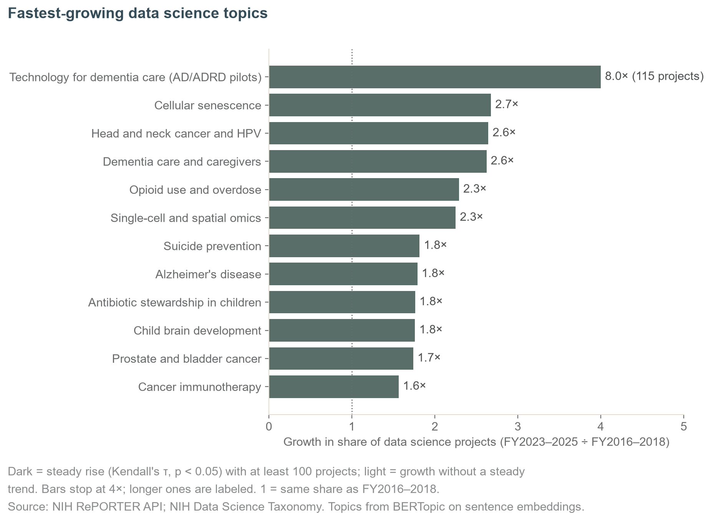
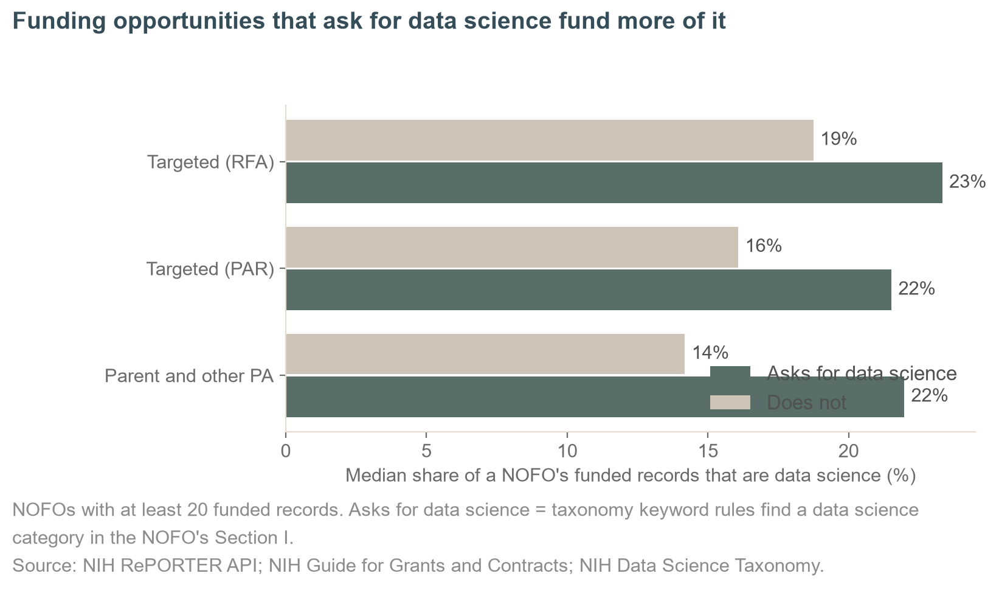
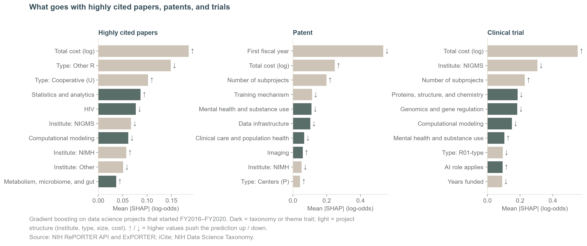

# What data science at NIH works on, where it's growing, and where it's thin

**Laura Ellis** · [LinkedIn](https://www.linkedin.com/in/laura-ellis-profile/) · [GitHub](https://github.com/Laura-Ellis/nih-ds-taxonomy) · Data FY2016 to FY2025 (NIH RePORTER API, as of October 24, 2026) · [Presentation (PDF)](https://laura-ellis.github.io/pdf/what_data_science_at_nih_works_on.pdf)

Most growth in NIH data science follows institute priorities: dementia at NIA, opioids at NIDA, cancer at NCI. The exception is single-cell and spatial omics, a method growing across many institutes at once.

Compared with U.S. disease burden, data science is thinnest in musculoskeletal, chronic respiratory, and heart disease. NIH's overall funding is light in the same areas, and few targeted funding calls match their projects. Calls that ask for data science fund more of it. A project's size and type predict its patents and trials far better than any data science trait.

Terms are defined in the [glossary](#glossary) at the end.

## Contents

1. [What data science works on](#1-what-data-science-works-on)
2. [What's rising](#2-whats-rising)
3. [Where it's thin relative to need](#3-where-its-thin-relative-to-need)
4. [What draws it in](#4-what-draws-it-in)
5. [Matching projects to funding calls](#5-matching-projects-to-funding-calls)
6. [What goes with patents, trials, and highly cited papers](#6-what-goes-with-patents-trials-and-highly-cited-papers)
7. [What this means](#7-what-this-means)
8. [Method, data, and limits](#8-method-data-and-limits)
9. [Glossary](#glossary)

## 1. What data science works on

I grouped 45,803 data science project abstracts into topics with two methods, LDA and BERTopic. BERTopic found 112 topics, which I named by hand and grouped into 25 themes.

The largest theme in FY2025 is research cores, centers, and data resources (9.9% of active data science projects). Next are aging and dementia (7.2%), mental health and substance use (6.9%), and heart, lung, kidney, and liver (6.7%).

Topics and the taxonomy sort projects in different ways. Topics follow the disease or system a project studies; the taxonomy follows the method it uses. They barely overlap (0.07 to 0.11 on a 0 to 1 scale), so they work best together.

## 2. What's rising

A fast riser grew at least 1.5 times in share from FY2016–18 to FY2023–25, rose steadily, and has at least 100 projects.

Most fast risers come mainly from one institute:

- Dementia care and caregivers: NIA 94%. Alzheimer's disease: NIA 90%.
- Opioid use and overdose: NIDA 85%. Suicide prevention: NIMH 62%.
- Prostate and bladder cancer: NCI 88%. Cancer immunotherapy: NCI 76%.

These rises track institute priorities and budgets, not something specific to data science.

Single-cell and spatial omics (2.3×) is the exception. No institute holds more than a third of it (NIGMS has 32%), and it's the only fast riser that is a method rather than a disease.

Charts for every institute with at least 500 data science projects are in [reports/figures/topics/ic](../../reports/figures/topics/ic/).

## 3. Where it's thin relative to need

I compared each disease group's share of U.S. disease burden with its share of NIH data science funding. Burden is measured in DALYs, years of healthy life lost (IHME Global Burden of Disease 2023).

| Disease group | Share of burden | Share of data science funding | Gap ratio |
|---|---:|---:|---:|
| Musculoskeletal disorders | 9.7% | 1.3% | 0.13 |
| Chronic respiratory diseases | 5.4% | 0.7% | 0.14 |
| Cardiovascular diseases | 15.2% | 5.0% | 0.33 |
| Respiratory infections and TB | 1.3% | 8% | 5.9 |
| HIV/AIDS and STIs | 0.4% | 9% | 26 |

A gap ratio of 1 means funding is in proportion to burden; below 1 means thin. Self-harm and violence, injuries, and skin disease are also low.

Data science mostly follows NIH's own funding. Musculoskeletal disorders get 1.5% of all NIH funding, and cardiovascular disease 6.5%. Even after accounting for that, data science lags most in chronic respiratory, skin, digestive, diabetes and kidney, and cardiovascular disease.

## 4. What draws it in

NIH funds projects through notices of funding opportunity (NOFOs). Some are targeted calls for an area (RFAs and PARs); others are broad, such as the parent R01. I collected the text of the 2,913 NOFOs behind 95% of data science projects and flagged those that ask for data science.

Calls that ask for data science fund more of it. The typical share of data science projects:

- RFAs: 23% when they ask, 19% when they don't.
- PARs: 22% vs. 16%.
- Broad announcements: 22% vs. 14%.

Still, most data science comes in through broad parent R01 announcements that never mention it. One of them (PA-20-185) funded 3,349 data science projects.

Some topics have no matching targeted call. Few of their projects come through RFAs or PARs: heart disease (27%), hearing (33%), bone and joint (30%), retina and glaucoma (27%), stroke (30%), and anxiety and depression (27%). Heart and musculoskeletal disease are also thin relative to burden, so the same areas lack both funding and calls that ask for data science.

## 5. Matching projects to funding calls

Can a model read a project's abstract and find the call it was funded under? I tested eight methods, plus two ways of combining the best two, on 2,000 projects, each against all 2,482 targeted calls. The real funding link is the answer key.

| Method | Right call ranked first | In top 5 | In top 10 | MRR |
|---|---:|---:|---:|---:|
| Tuned blend: 60% word matching + 40% PubMedBERT | 21% | 41% | 47% | 0.30 |
| Word matching (TF-IDF) | 20% | 40% | 47% | 0.29 |
| Equal rank fusion: word matching + PubMedBERT | 19% | 39% | 45% | 0.28 |
| PubMedBERT (biomedical) | 16% | 33% | 40% | 0.24 |
| MedCPT + its reranker (PubMed search) | 15% | 31% | 37% | 0.23 |
| BGE-M3 (reads long text) | 15% | 30% | 36% | 0.22 |
| Small general model (MiniLM) | 13% | 28% | 35% | 0.21 |
| MedCPT alone | 13% | 28% | 34% | 0.21 |
| Web-search reranker | 11% | 25% | 32% | 0.18 |

Plain word matching still beats every AI model on its own. An application and its call share exact terms, such as program names, required elements, and diseases. Biomedical models do better than general ones (PubMedBERT 40% vs. MiniLM 35% in the top 10), but they match on topic, and many calls share a topic. Reading longer text (BGE-M3) and reranking (MedCPT) didn't close the gap.

Combining helps a little, if the mix leans on word matching. An equal mix adds nothing. A blend of 60% word matching and 40% PubMedBERT ranks the right call higher (MRR 0.274 to 0.291 on held-out projects, a 6% gain; 95% CI for the gain 0.008 to 0.026), but it doesn't find more calls: the top 10 stays at 47%. I picked the weight on a random half of the projects and checked it on the other half, so the gain isn't tuned to the projects it's reported on. Weights from 0.3 to 0.7 all beat word matching alone (`reports/results/nofo_hybrid_weights.csv`).

MRR (mean reciprocal rank) = average of 1 ÷ the rank of the right call. Tuned blend = 0.6 × z(word-matching score) + 0.4 × z(PubMedBERT score), where z standardizes each score within a project. Equal rank fusion = 1 ÷ (60 + rank), summed.

## 6. What goes with patents, trials, and highly cited papers

I looked at 15,729 data science projects that started FY2016 to FY2020, so each has had at least five years to produce results. Models predicted three outcomes from the project's data science methods, AI use, research theme, and structure (cost, type, institute, and length).

The models predict trials and patents well and highly cited papers less well (AUC 0.83, 0.80, and 0.68; 0.5 = coin flip, 1 = perfect).

Project structure matters most. Total cost is the top driver of all three outcomes. Beyond structure:

- Statistics and analytics go with highly cited papers.
- Data infrastructure goes with fewer patents.
- Applying AI goes with more trials; computational modeling goes with fewer.

To check the two strongest traits, I compared projects with and without each trait after making them alike in size, type, and institute:

- Mental health and substance use: 7.1 points more likely to have a clinical trial (16% vs. 8%) and 7.3 points less likely to have a patent (2% vs. 11%).
- Computational modeling: 2.5 points less likely to have highly cited papers, and 2.2 points less likely to have a trial.

## 7. What this means

Target the thin areas. Heart, musculoskeletal, and chronic respiratory disease carry large shares of burden, small shares of data science funding, and few calls that ask for it. Calls written for these areas are the most direct lever, though most of the gap reflects NIH's overall funding.

Read rises by institute. Dementia, opioids, and cancer immunotherapy grow with NIA, NIDA, and NCI priorities. Single-cell and spatial omics is the one method growing across institutes; it is a candidate for shared infrastructure and training.

Judge outputs by area. Mental health projects are more likely to have a trial and less likely to have a patent. The fair way to credit data science projects is to compare them with others in the same area, type, and size.

## 8. Method, data, and limits

**Data:** 45,803 data science projects with abstracts (NIH Data Science Taxonomy), FY2016 to FY2025, NIH RePORTER API; NIH Guide text for 2,913 NOFOs; IHME GBD 2023 U.S. DALYs, averaged over 2016 to 2023; ExPORTER publication, patent, and clinical study links; iCite Relative Citation Ratio.

**Topics:** LDA (scikit-learn; 20 topics, chosen from 20, 30, and 40 by UMass coherence); BERTopic on all-MiniLM-L6-v2 embeddings with UMAP and HDBSCAN. Agreement measured by normalized mutual information (NMI): BERTopic vs. taxonomy 0.07, LDA vs. taxonomy 0.11, LDA vs. BERTopic 0.36. Fast riser: growth ≥ 1.5, Kendall's τ p < 0.05, at least 100 projects. Share = active data science projects in the theme ÷ all active data science projects that FY.

**Burden:** GBD level 3 causes summed to level 2, matched to RCDC categories through [rcdc_gbd_crosswalk.csv](rcdc_gbd_crosswalk.csv). Funding share uses attributed cost of data science records whose RCDC categories match the cause.

**Matching:** NOFO Section I split into ~200-word chunks and scored by the best chunk. Mean reciprocal rank: TF-IDF 0.29, embeddings 0.21, cross-encoder 0.18. Mean reciprocal rank: TF-IDF 0.29, hybrid 0.29, PubMedBERT 0.24, MedCPT + reranker 0.23, BGE-M3 0.22, MedCPT 0.21. A project can fit more than one NOFO, so these are lower bounds. Biomedical models: NeuML/pubmedbert-base-embeddings; ncbi/MedCPT-Article-Encoder and MedCPT-Cross-Encoder (reranks the top 20); BAAI/bge-m3 on ~1,000-word chunks up to 2,048 tokens. Hybrid = reciprocal rank fusion of TF-IDF and PubMedBERT (`nofo_match_bio.py`).

**Impact:** highly cited = mean RCR in the top quarter of projects with papers (23% of projects); patent 10%; trial 8%. Five-fold cross-validated ROC AUC; logistic regression comes within 0.01 to 0.03 of random forest and gradient boosting. Drivers from SHAP values. Adjusted differences by augmented inverse probability weighting (AIPW, doubly robust), with 200 bootstrap samples.

**Code:** `analyses/topics/topics.py` (topics), `topic_themes.py` (themes and trends), `nofo_match.py` (NOFOs and matching), `gaps.py` (burden), `impact_models.py` (outputs); `src/nofo_pull.py` downloads the NOFO text. Everything runs locally with free, open models.

**Limits:**

- RCDC categories overlap, so shares don't sum to 100%, and 29 of 83 crosswalk matches are medium or low confidence (flagged in the tables).
- Burden is one measure of need. Scientific opportunity, cost, and other funders also matter.
- Citations, patents, and trials lag and depend on what's linked.
- The impact models show associations. Traits not in the data, such as a team's track record, can still explain the differences.

**Sources:** [IHME Global Burden of Disease 2023](https://www.healthdata.org/research-analysis/gbd); [NIH Guide for Grants and Contracts](https://grants.nih.gov/funding/nih-guide-for-grants-and-contracts); [NIH RePORTER](https://reporter.nih.gov/); [iCite](https://icite.od.nih.gov/).

## Glossary

| Term | Meaning |
|---|---|
| AIPW | A way to compare projects with and without a trait after making them alike in size, type, and institute |
| AUC | How well a model separates projects with an outcome from those without: 0.5 = coin flip, 1 = perfect |
| BERTopic, LDA | Two methods that group abstracts into topics by the words and meaning they share |
| Cross-encoder | A language model that reads two texts together and scores how well they match |
| DALY | Disability-adjusted life year: a year of healthy life lost to death or disability |
| Data science project | An NIH project whose aims or approach rely on data science, per the NIH Data Science Taxonomy |
| Embeddings | Numbers a language model gives each text so similar texts sit close together |
| PubMedBERT, MedCPT, BGE-M3 | Language models trained on biomedical text or PubMed searches; BGE-M3 reads long text |
| Gap ratio | Share of data science funding ÷ share of disease burden; 1 = in proportion, below 1 = thin |
| NOFO | Notice of funding opportunity. RFA and PAR = targeted calls for an area; PA = broad, such as the parent R01 |
| RCDC | NIH's research, condition, and disease categories, used to tag every project |
| Relative Citation Ratio (RCR) | Citations per year compared with the field's norm; 1 = a typical NIH paper |
| SHAP | How much each trait pushes a model's prediction up or down |
| TF-IDF | Word matching that gives more weight to words that are rare across documents |
